# Developer Guide

## Acknowledgements

* The project was set up from the CS2113 [tP template](https://github.com/NUS-CS2113-AY2627-S1/tp)
  (Gradle build, Checkstyle configuration and the GitHub Actions workflow).
* The structure of this Developer Guide follows the
  [SE-EDU AddressBook-Level3 Developer Guide](https://se-education.org/addressbook-level3/DeveloperGuide.html).
* Third-party libraries and tools:
  * [JUnit 5](https://junit.org/junit5/) for testing.
  * The [Shadow Gradle plugin](https://gradleup.com/shadow/) to package GameVault as a single JAR file.
  * [PlantUML](https://plantuml.com/) for the UML diagrams in this guide.

## Design & implementation
### Edit feature

The edit feature lets the user change a game's title, player range, play time and difficulty without deleting and
re-adding it. Tags are changed with `tag` and `untag` instead, so `edit` keeps them as they are.

**Parsing.** `Parser#parseEdit` splits the arguments just before each field prefix (`/title`, `/min`, `/max`,
`/time`, `/diff`),
so the fields can be given in any order. The first part is the `INDEX`, which is checked by `Parser#parseIndex`
(shared with `delete`). Each field is then checked on its own, e.g. `MIN` must be a whole number of at least 1,
and `TITLE` must not contain `|`. A field that is not given is passed to `EditCommand` as `null`,
meaning "keep the current value".

**Execution.** `EditCommand#execute` first checks that a game with that number exists. It then builds the new game,
taking each given field and falling back to the existing game's value for any field that was not given. Only then is
`MAX >= MIN` checked, because this rule depends on the game's current values (e.g. `edit 1 /min 5` must fail if the
game's current maximum is 4). If the check passes, `GameList#set` replaces the game at the same position and
`Storage#save` writes the updated collection to the data file.

**Design considerations.**
* *Where to check MIN/MAX:* the parser does not have access to the game list, so it cannot know the game's
  existing values. The check is therefore done in `EditCommand`, in the same way that `DeleteCommand` checks
  whether the index exists when it runs.
* *Replace in place vs. delete and re-add:* replacing keeps the game's number in `list` unchanged,
  which is less confusing for the user.

<!-- @@author SwaggyDaddy67 -->
### Find feature

The find feature lets the user locate games by part of their title, e.g. `find mono` shows "Monopoly", without
scrolling through the whole collection. Each result is shown with its number from `list`, so the user can pass it
straight to `delete`, `edit` or `tag`.

**Parsing.** `Parser#parse` recognises the `find` command word and calls `Parser#parseFind`, which trims the rest of
the input, replaces each run of spaces inside it with a single space, and uses the result as the keyword. The whole
remaining text is one keyword, so `find ticket to` looks for the phrase "ticket to" rather than two separate words,
and `find ticket   to` finds the same games. An empty keyword is rejected with a `GameVaultException` that shows
the correct format. Otherwise, a `FindCommand` holding the keyword is returned.

**Execution.** The sequence diagram below shows what happens when the user enters `find mono`.

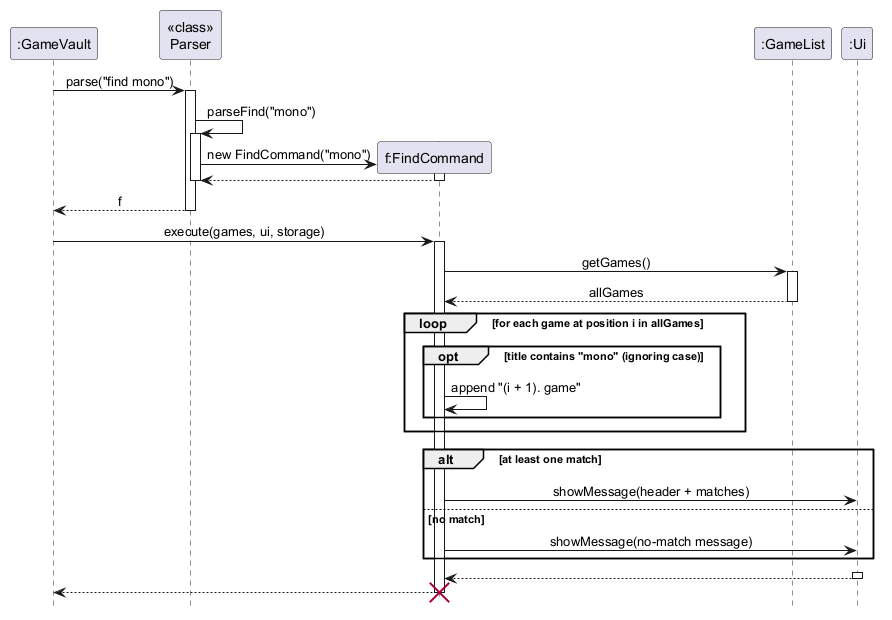

1. `FindCommand#execute` gets a read-only view of the collection from `GameList#getGames()`.
2. It prepares the keyword once with `FindCommand#toSearchText(...)`, which lower-cases it and replaces each run of
   whitespace with a single space. Lower-casing uses `Locale.ROOT`, so the result is the same on every computer (in
   Turkish, for example, the default lower case of `I` is a dotless `ı`). It then goes through the games
   **by position**. For each game whose title, prepared in the same way, contains the keyword, it adds a line made of
   the game's position plus one (the number `list` shows) and the game. Preparing the title too means a title saved
   with extra spaces, e.g. `Ticket  to Ride`, is still found.
3. If at least one game matched, the header and the matching lines are passed to `Ui#showMessage`. Otherwise,
   a "no games have ... in the title" message is shown instead.

`find` does not change the collection, so it does not call `Storage`.

**Design considerations.**

**Aspect: How results are numbered**

* **Alternative 1 (current choice):** Show each match with its number from `list`.
  * Pros: The number can be used directly with `delete`, `edit` or `tag`, which is the main reason to search.
  * Cons: Results are not numbered 1, 2, 3, which may look odd at first (e.g. `2.` followed by `5.`).
* **Alternative 2:** Number the results from 1, like a new list.
  * Pros: Looks tidier.
  * Cons: The numbers would not match `list`, so `delete 1` after a search could delete the wrong game.
    This is the reason `filter` and `pick` do not number their results at all.

**Aspect: Where the search happens**

* **Alternative 1 (current choice):** `FindCommand` loops over `GameList#getGames()` itself.
  * Pros: Keeps each game's position available while searching, and needs no change to `GameList`.
* **Alternative 2:** Add a `GameList#findByTitle(keyword)` method that returns the matching games, like
  `GameList#filterByPlayers`.
  * Cons: It would return only the games, losing their positions, so `FindCommand` would have to look each one up
    again to number it.

**Aspect: Matching rule**

We use a case-insensitive "contains" match because users usually remember part of a title but not its exact
spelling or capitalisation. Matching whole words only (e.g. `cat` not finding "Catan") was rejected because it
would make short keywords much less useful.

### Sort feature

The sort feature reorders the whole collection by title, player count or play time, e.g. `sort time`, then saves it
and shows the new numbered list.

The class diagram below shows the classes involved.

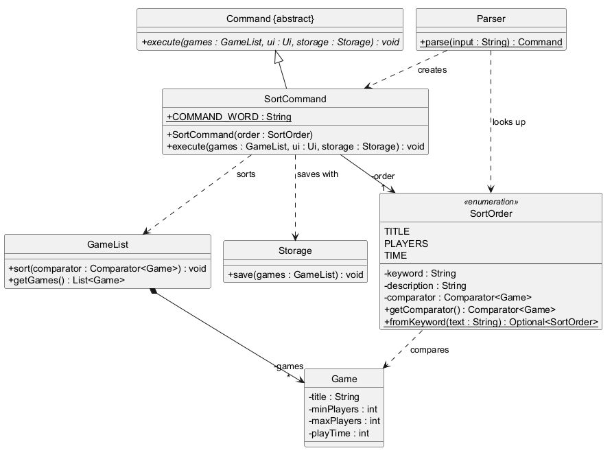

* `SortOrder` is an enumeration of the supported orders: `TITLE`, `PLAYERS` and `TIME`. Each value holds the keyword
  the user types (e.g. `time`), a description shown after sorting, and the `Comparator<Game>` that defines the order.
* `SortCommand` holds one `SortOrder` and does the sorting when executed.
* `GameList#sort(Comparator<Game>)` reorders the games in place.

**The three orders.**
* `TITLE`: alphabetical, ignoring case.
* `PLAYERS`: by minimum players, then by maximum players.
* `TIME`: shortest play time first. A game with no play time recorded is treated as taking `Integer.MAX_VALUE`
  minutes, so it always comes after every game whose play time is known. This value is only used inside the
  comparator. It is never shown to the user or saved, and the game itself still has no play time.

Games that tie in `PLAYERS` or `TIME` are ordered by title. This makes the result depend only on the games
themselves, not on the order they were in before, so sorting twice gives the same result.

**Parsing and execution.** The sequence diagram below shows what happens when the user enters `sort time`.

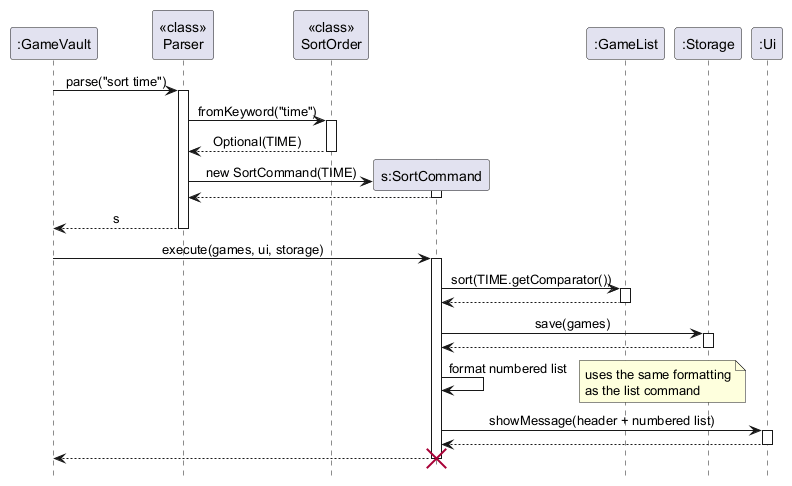

1. `Parser#parseSort` looks up the keyword with `SortOrder#fromKeyword`, which ignores case (using `Locale.ROOT`, as `find` does)
   and surrounding spaces, and returns an empty `Optional` for an unknown keyword. A missing or unknown keyword is rejected with an error that
   lists the valid choices. The list comes from `SortOrder#describeKeywords`, so it stays correct if an order is added.
2. `SortCommand#execute` passes the order's comparator to `GameList#sort`, which uses the stable `List#sort`.
3. The new order is saved with `Storage#save`, so `list` keeps showing it after the app restarts.
4. The sorted games are shown numbered from 1, using `ListCommand#formatNumberedListWithLastPlayed`, which `list`
   also uses, so each game shows when it was last played.
   An empty collection is not sorted or saved; a message is shown instead.

**Adding a new order** only needs a new `SortOrder` value with its keyword, description and comparator.
`Parser`, `SortCommand` and the error messages do not need to change.

**Design considerations.**

**Aspect: Reorder the collection vs. show a sorted view**

* **Alternative 1 (current choice):** Reorder the collection itself and save it.
  * Pros: The order lasts, and the numbers shown after sorting are the real `list` numbers, so they can be used
    with `delete`, `edit` or `tag` straight away.
  * Cons: The user's original order (the order games were added) is lost, and every game's number may change.
    The UG warns about this.
* **Alternative 2:** Show a sorted copy without changing the collection.
  * Pros: Keeps the original order.
  * Cons: The numbers shown would not match `list`, which is the problem the find feature also avoids.

**Aspect: How orders are represented**

* **Alternative 1 (current choice):** An enumeration that pairs each keyword with its comparator.
  * Pros: Only valid orders can exist, and each order's details are kept in one place.
* **Alternative 2:** A `switch` on the keyword inside `SortCommand`.
  * Cons: The keyword list, the descriptions and the comparators would be spread across several places, and adding
    an order would mean changing each of them.

#### Possible future improvements

* Allow a descending order, e.g. `sort time /desc` for the longest games first.
* Keep games in order automatically, so a newly added game goes to its sorted position instead of the end of the list.
* Sort by more than one key, e.g. by player count, then by play time.
<!-- @@author -->

<!-- @@author MohamedFarsat -->
### Picking a random game (`pick`)

The `pick` command helps a host who cannot decide what to play. It picks one random game that fits tonight's
group, using the format `pick COUNT [/time MINUTES]`, e.g. `pick 4 /time 45`. It is implemented by
`Parser#parsePick` and `PickCommand`, and reuses the filtering methods of `GameList`, so `pick` and `filter` always
agree on which games fit. The pick is weighted by the group's ratings (see
[Rating games and weighted picking](#rating-games-and-weighted-picking)), and lent or unavailable games are left out
(see [Lending games to friends](#lending-games-to-friends) and [Marking a game unavailable](#marking-a-game-unavailable)).

The sequence diagram below shows what happens when the user enters `pick 4 /time 45`.

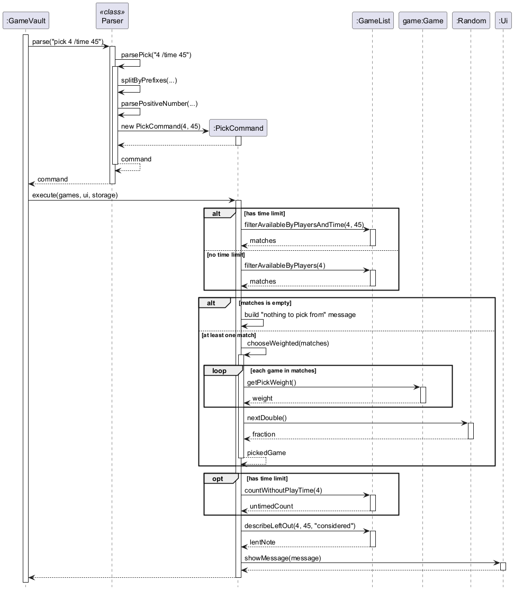

1. `Parser#parse(...)` sees the command word `pick` and calls `Parser#parsePick(...)`. `parsePick` uses
   `Parser#splitByPrefixes(...)` to separate `COUNT` (`4`) from the optional `/time` value (`45`), and checks both
   with `Parser#parsePositiveNumber(...)`, so an invalid value such as `pick 0` or `pick 4 /time soon` is rejected
   with a `GameVaultException` before any command is created.
2. `parsePick` creates a `PickCommand(4, 45)`. If `/time` is not given, it uses `PickCommand(4)` instead, which
   stores `0` to mean "no time limit".
3. `GameVault` calls `PickCommand#execute(...)`. With a time limit, it asks the `GameList` for
   `filterAvailableByPlayersAndTime(4, 45)`. Without one, it uses `filterAvailableByPlayers(4)`. Both keep only games
   for which `Game#isAvailable()` is true, so lent and unavailable games are left out. Either way, the collection
   itself is not
   changed, so `pick` never saves to the data file.
4. If no game matches, the message says there is nothing to pick from. Otherwise, `PickCommand#chooseWeighted(...)`
   asks each match for its `Game#getPickWeight()` and adds them up. It then takes a random point along that total
   (`Random#nextDouble()` times the total) and picks the game whose share the point falls in, so games rated up are
   more likely to be chosen. If some match has a weight other than 1, the message says that ratings were used.
5. Only with a time limit, `PickCommand` also calls `GameList#countWithoutPlayTime(4)`. Games with no play time
   recorded cannot be known to fit in 45 minutes, so they are left out, and the message says how many were left
   out. This matches what `filter` does.
6. `PickCommand` calls `GameList#describeLeftOut(4, 45, "considered")`, which finds the lent games that would
   otherwise have fitted and turns them into a note such as
   `(Not considered because they are lent out: Catan (to Alice))`, or an empty string if there are none.
7. `PickCommand` shows the result through `Ui#showMessage(...)`, e.g.
   `How about: Love Letter (2-4 players, 20 min)`.

#### Design considerations

**Aspect: How to make a random result testable**

* **Alternative 1 (current choice):** `PickCommand` takes a `Random` object. The public constructors create a
  normal `new Random()`, while a package-private constructor lets tests pass in their own.
  * Pros: Tests can pass a `Random` whose `nextDouble()` always returns a chosen value, so they can check exactly
    which game is picked, e.g. that a point 70% along the total weight lands on the second game, and that a game
    that does not fit is never chosen.
  * Cons: One extra constructor that only tests use.
* **Alternative 2:** Call `Math.random()` (or create a `new Random()`) inside `execute(...)`.
  * Pros: Slightly less code.
  * Cons: Tests could only check that *some* matching game was picked, not which one, so bugs such as an
    off-by-one in the weighted choice could go unnoticed.

**Aspect: Where the filtering logic lives**

* **Alternative 1 (current choice):** Reuse `GameList#filterAvailableByPlayers(...)` and
  `GameList#filterAvailableByPlayersAndTime(...)`, which `filter` also uses.
  * Pros: `pick` and `filter` cannot disagree. A game shown by `filter 4 /time 45` is exactly a game that
    `pick 4 /time 45` can choose, and a fix to the filtering rules applies to both commands.
  * Cons: `pick` depends on how `filter` defines "fits", so the two cannot easily use different rules later.
* **Alternative 2:** Let `PickCommand` check each game itself.
  * Pros: `pick` could later use its own rules without affecting `filter`.
  * Cons: The same checks would exist in two places, which is duplicate code and makes the commands more likely
    to drift apart.

**Possible future improvement:** `pick` could use the play sessions recorded with `log` to avoid games the group
played recently, so the same favourite is not suggested every time.
<!-- @@author -->

### Saving and loading games (Storage)

GameVault keeps the user's game collection between runs by saving it to a plain text file, `data/games.txt`.
This is handled by the `Storage` component in the `seedu.gamevault.storage` package, which has two classes:

* `Storage` reads the data file when the app starts and rewrites it whenever the collection changes.
* `GameDecoder` turns one line of the file back into a `Game`, checking that the line is valid.

Each game is stored on its own line in the format `TITLE | MIN | MAX | TIME | TAGS`, where `MIN` and `MAX` are the
minimum and maximum player counts, `TIME` is the play time in minutes and `TAGS` is the game's tags, separated by
commas. `TIME` and `TAGS` are optional:

* A game with no tags has no `TAGS` field, and `TIME` is left out too if no play time is recorded.
* A game with tags always has `TAGS` as the fifth field, so `TIME` is left blank if there is no play time.
* Any further data comes after `TAGS` as named `KEY=VALUE` fields, in any order. A game with a named field
  always has `TIME` and `TAGS` (possibly blank) first. The current named fields are:
  * `sessions` (see [Logging a play session](#logging-a-play-session))
  * `ratings` (see [Rating games and weighted picking](#rating-games-and-weighted-picking))
  * `unavailable` (see [Marking a game unavailable](#marking-a-game-unavailable))
  * `lent` (see [Lending games to friends](#lending-games-to-friends))
  * `difficulty` (see [Difficulty levels](#difficulty-levels))
  * `from` and `due` (see [Recording who lent or gave a game](#recording-who-lent-or-gave-a-game))

For example:

```
Catan | 3 | 4 | 60
Love Letter | 2 | 4
Azul | 2 | 4 | 45 | family,strategy
Codenames | 4 | 8 |  | party,word
Hive | 2 | 2 |  |  | lent=Alice
Carcassonne | 2 | 5 | 35 |  | sessions=2026-10-25@3;2026-10-30@4
```

The class diagram below shows how these classes relate to the rest of the app.

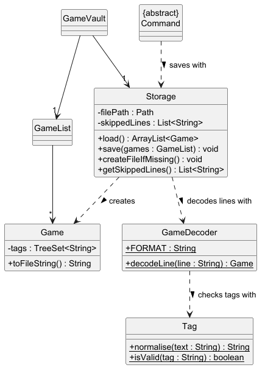

`GameVault` owns a single `Storage` object, created with the path of the data file. Commands that change the
collection (currently `add`, `delete`, `edit`, `tag`, `untag`, `sort`, `lend`, `return` and `log`) receive the
same `Storage` object in `Command#execute(...)` and use it to save. `Storage` depends on `GameDecoder` only for
loading; saving uses `Game#toFileString()` directly.
`GameDecoder` uses `Tag` to check each tag in the file with the same rules as tags typed by the user.

#### Loading games at startup

When GameVault starts, `GameVault#loadGames()` asks `Storage` to prepare the data file and then load it.
The sequence diagram below shows what happens.

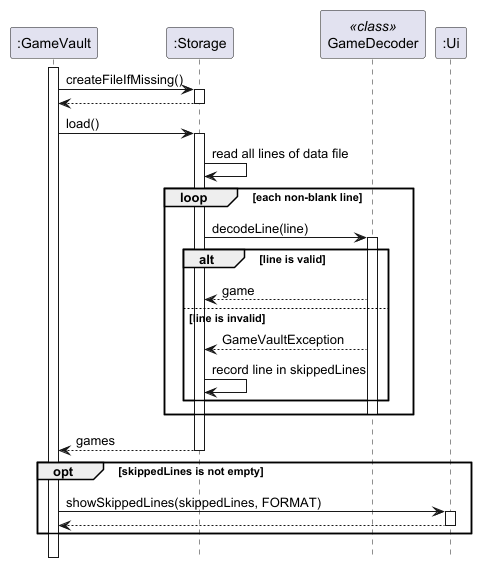

1. `GameVault` calls `Storage#createFileIfMissing()`, which creates the `data/` folder and an empty
   `games.txt` if they do not exist yet. An existing file is left untouched.
2. `GameVault` calls `Storage#load()`. If the file does not exist (e.g. it could not be created in step 1),
   `load()` returns an empty list, since a new user simply has no games yet.
3. Otherwise, `load()` reads every line of the file. Blank lines are ignored. Each other line is passed to
   `GameDecoder#decodeLine(...)`, which splits it on `|`, trims each part and checks that:
   * there are at least three parts,
   * `TITLE` is not empty,
   * `MIN` and `MAX` are whole numbers of at least 1,
   * `MAX` is not less than `MIN`,
   * `TIME`, if present and not blank, is a whole number of at least 1. A missing or blank `TIME` means no play
     time is recorded, and
   * each tag in `TAGS`, if present, follows the tag rules once `Tag#normalise(...)` has trimmed it and put it in
     lower case, as checked by `Tag#isValid(...)`. Blank entries (e.g. from a trailing comma) and repeated tags
     are ignored, and
   * every part after `TAGS` is a `KEY=VALUE` field whose key is known and not repeated, and whose value is valid
     (see `GameDecoder#decodeNamedField(...)`).
4. A valid line becomes a `Game`. An invalid line causes `GameDecoder` to throw a `GameVaultException` whose
   message says exactly what is wrong (e.g. `MAX (2) is less than MIN (3)`). `Storage` catches it, records the
   line number, the line and the reason in its `skippedLines` list, and moves on to the next line.
5. `load()` returns the games from all the valid lines, and `GameVault` puts them into a new `GameList`.
6. If any lines were skipped, `GameVault` gets them from `Storage#getSkippedLines()` and passes them to
   `Ui#showSkippedLines(...)`, together with `GameDecoder.FORMAT`, so the user can see which lines were ignored
   and how to fix them.

If the file exists but cannot be read at all, `load()` throws a `GameVaultException`. `GameVault` shows the error
and starts with an empty collection instead of exiting.

#### Saving games after a change

Every command that changes the collection saves it straight away, so no changes are lost if the app closes
unexpectedly. The sequence diagram below shows this for the `add` command.

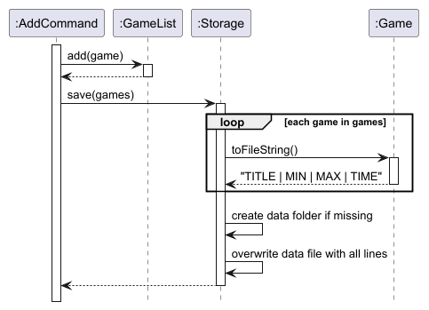

1. `AddCommand` adds the new game to the `GameList`.
2. `AddCommand` calls `Storage#save(games)`.
3. `save()` asks each `Game` for its line in the file through `Game#toFileString()`.
4. `save()` creates the `data/` folder if it is missing, then writes all the lines to the file, replacing its
   old contents.
5. If writing fails, `save()` throws a `GameVaultException`, which `GameVault` shows to the user as an error.

`DeleteCommand` and `EditCommand` save in the same way after removing or replacing a game.

#### Design considerations

**Aspect: File format**

* **Alternative 1 (current choice):** Plain text, one game per line, with fields separated by `|`.
  * Pros: Easy to implement with no extra libraries. Users can read and edit the file in any text editor.
  * Cons: The `|` character cannot be used in a game title without adding an escaping scheme.
* **Alternative 2:** JSON, using a library such as Jackson or Gson.
  * Pros: Handles special characters and lists of values (such as a game's tags) without extra rules.
  * Cons: Adds a third-party dependency, and the file is harder for users to edit by hand.

We chose plain text because each game has only a few simple fields, so the extra power of JSON is not needed yet.
New fields are added as optional fields at the end of the line, so data files saved by older versions still load:
when play time was added, `TIME` became an optional fourth field, and when tags were added, `TAGS` became an
optional fifth field. Tags may only contain letters, digits and hyphens, so a tag can never contain the `|` or `,`
that separate fields and tags, and no escaping is needed. If games gain many more fields later, switching to JSON
would only require changes inside the `Storage` component.

**Aspect: How to add more optional fields** (added in v2.1)

* **Alternative 1 (current choice):** Fields after `TAGS` are named `KEY=VALUE` fields, e.g. `sessions=...`.
  * Pros: Fields can be in any order and are only written when there is data, so adding a new kind of data
    (sessions, difficulty, ratings, ...) never changes how existing lines are read. Lines stay short.
  * Cons: Slightly more code in `GameDecoder`, and keys take up some space in the file.
* **Alternative 2:** Keep adding numbered fields (a sixth, seventh, ... field).
  * Pros: Same approach as `TIME` and `TAGS`.
  * Cons: Every game with any later field needs blanks for all the fields before it, and every developer adding a
    field must agree on the column order.

We chose Alternative 1 because several v2.1 features each add optional data. To store a new kind of data, add a
named field in `Game#getNamedFileFields()` and a matching `case` in `GameDecoder#decodeNamedField(...)`. Unknown
or repeated keys make the line invalid, so a typo in a hand-edited file is reported rather than silently dropped.

**Aspect: What to do with invalid lines when loading**

* **Alternative 1 (current choice):** Skip each invalid line, keep the valid ones, and tell the user which lines
  were skipped and why.
  * Pros: One mistake made while editing the file by hand does not cost the user their whole collection.
  * Cons: Skipped lines are lost the next time the collection is saved, because `save()` rewrites the file from
    the games in memory.
* **Alternative 2:** Stop loading and start with an empty collection as soon as one line is invalid.
  * Pros: Simpler to implement.
  * Cons: A single typo makes every game disappear, and the next save would overwrite the whole file.

We chose Alternative 1 because losing a few broken lines is much less harmful than losing every game. Showing the
exact line and reason lets the user fix the file before making further changes.

**Aspect: How to save**

* **Alternative 1 (current choice):** Rewrite the whole file after every change.
  * Pros: Simple, and works the same way for adding, deleting and any future editing commands.
  * Cons: Slower for very large collections, as every game is written each time.
* **Alternative 2:** Append a line when a game is added, and only rewrite the file for other changes.
  * Pros: Faster for the most common change.
  * Cons: Needs different saving logic for each kind of change, which makes bugs more likely.

We chose Alternative 1 because a game-night collection is small (tens to hundreds of games), so rewriting the
file takes very little time.

**Aspect: Where `GameDecoder` sits**

Decoding is kept in its own class instead of inside `Storage`, so that `Storage` deals only with files while
`GameDecoder` deals only with the line format. This also lets `GameDecoder` be unit-tested with plain strings,
without creating any files.

#### Possible future improvements

* Back up the data file (e.g. to `games.txt.bak`) before overwriting it whenever some lines were skipped during
  loading, so that the user can still recover those lines.
* Write to a temporary file first and then rename it over `games.txt`, so that a crash in the middle of saving
  cannot leave a half-written file.

<!-- @@author Xandurs -->
### Logging a play session

The `log` command records that a game was played, e.g. `log 1 /players 4 /date 2026-10-30`. The logged sessions
are what features such as "last played" are worked out from.

**Model.** A `PlaySession` stores a `LocalDate` and a player count, and cannot be changed once created. Each `Game`
holds an `ArrayList<PlaySession>`. `Game#addSession(...)` inserts each new session after every session on or
before its date, so the list is always sorted oldest first, and `Game#getLastPlayed()` simply returns the date of
the last session. Sessions on the same day stay in the order they were logged.

**Parsing.** `Parser#parseLog(arguments, today)` uses `splitByPrefixes(...)` to read `INDEX`, `/players` and the
optional `/date`. Today's date is passed in (`LocalDate.now()` in normal use) so that the rule "not in the future"
can be unit-tested with a fixed date. Without `/date`, the session is logged for today. `LocalDate.parse(...)`
is strict, so impossible dates such as `2026-02-30` are rejected rather than adjusted.

**Executing.** The sequence diagram below shows `log 1 /players 4 /date 2026-10-30`.

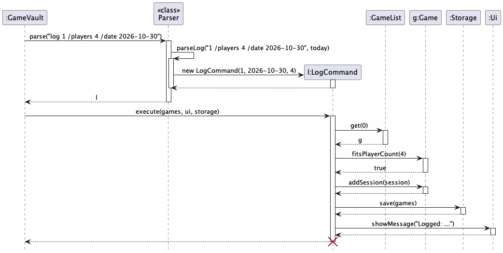

1. `LogCommand#execute(...)` checks that game 1 exists, then gets it from the `GameList`.
2. It checks that 4 is within the game's player range with `Game#fitsPlayerCount(4)`.
3. It adds the session with `Game#addSession(...)` and saves the collection with `Storage#save(...)`.
4. It shows the session and the game's new play count.

**Storage.** Sessions are saved in the named field `sessions`, each as `DATE@PLAYERS` and separated by `;`, e.g.
`Catan | 3 | 4 | 60 |  | sessions=2026-10-25@3;2026-10-30@4`. Because `EditCommand` builds a new `Game` when
editing, it copies the old game's sessions (as well as its tags) into the new one.

#### Design considerations

**Aspect: Player counts outside the game's range**

* **Alternative 1 (current choice):** Reject them, and suggest using `edit` to change the range first.
  * Pros: Catches typos such as `44` for `4`, and keeps the history consistent with the range that `filter` and
    `pick` use.
  * Cons: Groups that play with house rules must widen the game's range first.
* **Alternative 2:** Accept any count of at least 1.
  * Pros: More flexible.
  * Cons: A typo is saved silently and can only be removed by editing the data file.

**Aspect: Future dates in the data file**

The `log` command rejects future dates, but `GameDecoder` accepts them when loading. Otherwise a computer whose
clock is set wrongly would treat saved sessions as invalid and skip the whole game.

#### Possible future improvements

* An `unlog INDEX` command to remove a session logged by mistake.
* Accept other date forms, e.g. `today`, `yesterday` or `30/10/2026`.

### Showing when games were last played

`list` shows how long ago each game was last played (e.g. `Catan (3-4 players) - last played 3 days ago`), and
`filter COUNT /notplayedin DAYS` hides games played within the last `DAYS` days. Both are worked out from the play
sessions recorded by `log`, so nothing new is saved to the data file.

**Model.** Three methods in `Game` build on `Game#getLastPlayed()`:

* `getDaysSinceLastPlayed(today)` returns the number of days between the last session and `today`
  (`ChronoUnit.DAYS.between(...)`), or an empty `Optional` if the game was never played. It never returns a
  negative number, in case a hand-edited data file contains a session after today.
* `wasPlayedWithin(days, today)` returns whether that number is less than `days`, so with `days` = 14, a game played
  13 days ago counts as recent but one played 14 days ago does not. A never-played game is never recent.
* `describeLastPlayed(today)` turns the number into words: `last played today`, `last played 1 day ago`,
  `last played N days ago` or `never played`.

**Listing.** `ListCommand` already stores `today` (used for overdue borrowed games). Its static
`formatNumberedListWithLastPlayed(games, today)` numbers the games from 1 and adds ` - ` and
`Game#describeLastPlayed(today)` to the end of each line. `SortCommand` shows the sorted collection with the same
method, so the games look the same before and after `sort`. Like `ListCommand`, `SortCommand` takes today's date
through a package-private constructor, so tests can use a fixed date.

**Filtering.** `Parser#parseFilter(...)` reads the optional `/notplayedin DAYS` with `splitByPrefixes(...)` and
checks it with `parsePositiveNumber(...)`, then creates `FilterCommand(count, minutes, notPlayedInDays)`.
When `/notplayedin` is left out, `notPlayedInDays` is `FilterCommand.NO_DAYS_LIMIT` (0), so `filter` behaves
exactly as before. In `FilterCommand#execute(...)`:

1. The games that fit the player count (and time, if given) are found exactly as before.
2. If there is a day limit, `removeRecentlyPlayed(matches)` removes every game for which
   `Game#wasPlayedWithin(notPlayedInDays, today)` is true, and returns how many were removed.
3. The criteria line says `not played in the last N day(s)`, and if any games were removed, a note says how many
were left out, worded like the other notes, so the user knows why a game they expected is missing.
4. The notes about games with no play time (`countUntimedNotRecentlyPlayed(...)`) and lent games
   (`findLentNotRecentlyPlayed(...)`) skip games for which `isRecentlyPlayed(...)` is true. Otherwise a game
   played yesterday that is lent out would be named as if it would have been shown.


#### Design considerations

**Aspect: Store "last played" or work it out**

* **Alternative 1 (current choice):** Work it out from the logged sessions each time it is needed.
  * Pros: Nothing new to save or load, and it can never disagree with the play history.
  * Cons: Every `list` looks at each game's last session, but this is quick because sessions are kept in date order.
* **Alternative 2:** Store a `lastPlayed` date in each game and update it in `log`.
  * Pros: Slightly less work when listing.
  * Cons: The same fact is stored twice, and the two could disagree, e.g. after hand-editing the data file.

**Aspect: How to pass in today's date**

* **Alternative 1 (current choice):** Pass `today` into the `Game` methods, and give `ListCommand` and
  `FilterCommand` a package-private constructor that takes it. Normal use passes `LocalDate.now()`.
  * Pros: Tests can use a fixed date, so they don't start failing as the real date moves on.
  * Cons: One extra parameter and constructor.
* **Alternative 2:** Call `LocalDate.now()` inside `Game`.
  * Pros: Simpler method signatures.
  * Cons: Results change every day, so tests could only check vague things.

**Aspect: Never-played games with `/notplayedin`**

* **Alternative 1 (current choice):** Always show them.
  * Pros: Matches the goal of avoiding games played *recently*; a never-played game is a fresh choice.
  * Cons: A brand-new game appears even if the group hasn't decided whether they want it yet.
* **Alternative 2:** Hide them as well.
  * Pros: Shows only games with a known history.
  * Cons: Hides exactly the games the group has not tried, which goes against the point of the feature.

#### Possible future improvements

* Support `/notplayedin` together with `/tag`, and in `pick`, so a random pick also avoids recent games.
* Add `sort lastplayed`, to see the games that have gone longest without being played first.

<!-- @@author SwaggyDaddy67 -->
### Play history and unplayed games

`history INDEX` shows every session logged for one game, oldest first, with how many times it was played and how
long ago it was last played. `unplayed` lists the games with no sessions at all, so that games which keep being passed over get a
fair chance. Both only read the sessions recorded by `log`, so neither changes the collection or the data file.

**Parsing.** `Parser#parseHistory` trims the arguments and passes them to `Parser#parseIndex`, the same check used by
`delete` and `edit`, so a missing, non-numeric or too-small `INDEX` gives the same error messages. `unplayed` takes no
arguments, so `Parser#parse` calls `checkNoArguments(...)` and creates an `UnplayedCommand` directly, as for `list`.

**Viewing the history.** The sequence diagram below shows what happens when the user enters `history 1`.

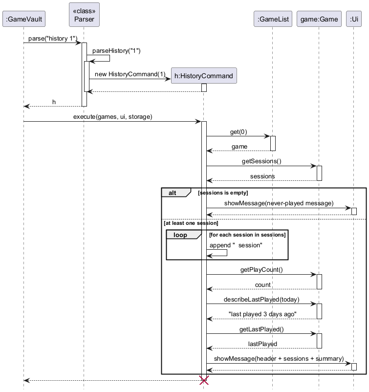

1. `HistoryCommand#execute` checks that game 1 exists (otherwise it throws the same "no game numbered" error as
   `delete`), then gets it with `GameList#get(0)`.
2. It gets the game's sessions with `Game#getSessions()`. These are already sorted oldest first by
   `Game#addSession(...)`, so no sorting is needed here.
3. If there are no sessions, it shows a message saying the game has never been played, with the format of `log`.
4. Otherwise, it adds one line per session (`PlaySession#toString()`, e.g. `2026-10-30 (4 players)`), then a summary
   line built from `Game#getPlayCount()`, `Game#describeLastPlayed(today)` and `Game#getLastPlayed()`, e.g.
   `Played 2 times in total, last played 3 days ago (2026-10-30).`, and passes the message to `Ui#showMessage`.

`Game#describeLastPlayed(today)` is the method `list` uses, so both commands word "last played" the same way. Like
`ListCommand`, `HistoryCommand` takes today's date through a package-private constructor, so tests can use a fixed
date. Normal use passes `LocalDate.now()`.

**Listing unplayed games.** `UnplayedCommand#execute` works in two steps. First, `findUnplayedNumbers(...)` goes
through `GameList#getGames()` by position, like `FindCommand`, and keeps the number (position plus one) of each game
whose `Game#getPlayCount()` is 0. Then `formatUnplayed(...)` builds the message: each of those games with its number,
a count line such as `2 of your 3 game(s) have never been played.`, and, if any of the games have
`Game#isAvailable()` false, a note that they cannot be played right now. An empty collection (which reuses `ListCommand.EMPTY_MESSAGE`) and a collection where every game has been played
each get their own message instead of an empty list.

#### Design considerations

**Aspect: How unplayed games are numbered**

* **Alternative 1 (current choice):** Show each game with its number from `list`.
  * Pros: The number can be passed straight to `log` or `history`, which is what the user usually does next.
  * Cons: The numbers have gaps, e.g. `2.` followed by `5.`.
* **Alternative 2:** Number the games from 1.
  * Pros: Looks tidier.
  * Cons: `log 1 ...` after `unplayed` could log the wrong game. `find` keeps the `list` numbers for the same reason.

**Aspect: Order of the sessions in `history`**

* **Alternative 1 (current choice):** Oldest first.
  * Pros: Matches the order `Game` already keeps, so no sorting or copying is needed, and reads like a diary.
  * Cons: For a game played many times, the most recent sessions are at the bottom.
* **Alternative 2:** Newest first.
  * Pros: The most recent session is seen first.
  * Cons: Needs a reversed copy of the list. The summary line already gives the last-played date, so the gain is small.

**Aspect: Unplayed games that are lent out or unavailable**

* **Alternative 1 (current choice):** List them with their status, and add a note saying how many cannot be played
  right now.
  * Pros: The list still answers "which games have we never tried", and the note stops the user planning a game
    night around a game that is not on the shelf.
  * Cons: The user has to read the status on each line to see which ones they are.
* **Alternative 2:** Leave them out, as `filter` and `pick` do.
  * Pros: Every game shown can be played tonight.
  * Cons: A game that is lent out for a while would drop out of the list, even though it has still never been played.

**Aspect: A new command or an option on an existing one**

`unplayed` could have been `filter /unplayed` or `list /unplayed`. A separate command was chosen because `filter`
always needs a player count while `unplayed` is about the whole collection, and an option on `list` would change a
command that users rely on to show every game.

#### Possible future improvements

* Show more statistics in `history`, e.g. the average number of players.
* Let `unplayed` take a player count, e.g. `unplayed 4`, to find unplayed games for tonight's group.

<!-- @@author MohamedFarsat -->
### Rating games and weighted picking

The `rate INDEX up|down` command lets the group give a game a thumbs up or a thumbs down after playing it, and
`unrate INDEX up|down` takes one back if it was given by mistake. `pick` then favours games with more thumbs up, so
its suggestions get better the more the group uses GameVault.

**Model.** `Game` keeps two `int` counts, `thumbsUp` and `thumbsDown`, both starting at 0. The `Thumb` enumeration
(`UP` or `DOWN`) says which count a method works on, e.g. `Game#addRating(Thumb.UP)`, and also holds the word the
user types for it, like `SortOrder` does for sorting. The counts change only through `Game#addRating(...)` and
`Game#removeRating(...)`, or `Game#setRatings(...)` when loading a game or copying it in `edit`. Like `lendTo(...)`,
these methods only assert their rules; `Game#canAddRating(...)` and `Game#canRemoveRating(...)` let commands check
first, so that the user can be told why nothing changed.
`Game#isRated()` is true once either count is above 0, and `Game#toString()` then adds the counts, e.g.
`Catan (3-4 players) +5/-1`. Because every command shows games through `toString()`, ratings appear in `list`,
`find`, `filter` and `pick` without changing those commands.

**Rating a game.** The sequence diagram below shows what happens when the user enters `rate 1 up`.

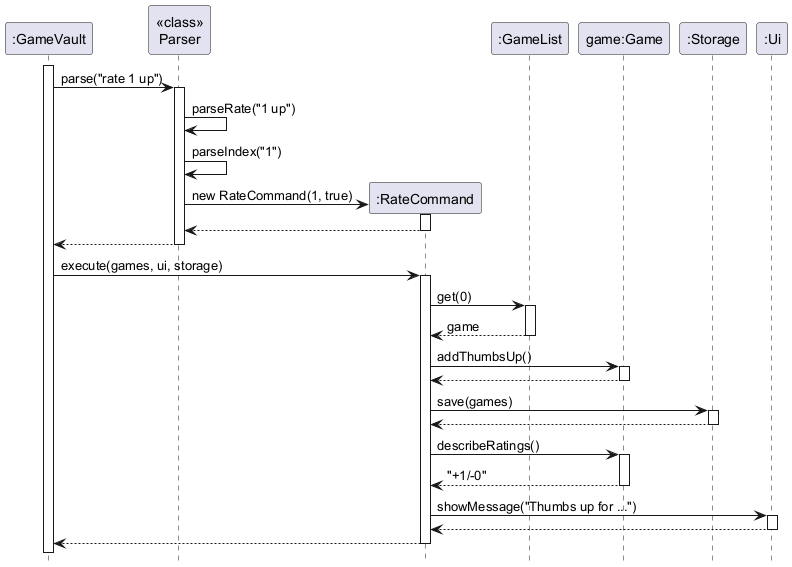

1. `Parser#parseRate(...)` calls `parseRatingArguments(...)`, which `unrate` shares. It splits the arguments on
   spaces and expects exactly two words. The first is checked by `parseIndex(...)`, shared with `delete`, `edit` and
   `lend`, and the second is looked up with `Thumb#fromKeyword(...)`, which ignores case.
2. `RateCommand#execute(...)` checks that game 1 exists, then gets it from the `GameList`.
3. It checks `Game#canAddRating(Thumb.UP)`. This is only false if the count is already `Integer.MAX_VALUE`
   (possible only by editing the data file), where adding 1 would wrap round to a negative number.
4. It calls `Game#addRating(Thumb.UP)`, saves the collection with `Storage#save(...)`, and shows the new counts from
   `Game#describeRatings()`.

`UnrateCommand` works the same way, but checks `Game#canRemoveRating(...)` (the count must be above 0) and calls
`Game#removeRating(...)`.

**Weighted picking.** `Game#getPickWeight()` returns `(thumbsUp + 1) / (thumbsDown + 1)`, kept between
`Game.MIN_PICK_WEIGHT` (0.2) and `Game.MAX_PICK_WEIGHT` (5). `PickCommand#chooseWeighted(...)`
adds up the weights of the matching games, takes a random point between 0 and that total
(`Random#nextDouble() * total`), and walks through the matches, subtracting each weight until the point falls inside
one game's share. For example, if Catan (`+3/-0`, weight 4), Codenames (unrated, weight 1) and Splendor (unrated,
weight 1) all fit, the total is 6 and Catan is picked whenever the point falls between 0 and 4, i.e. 4 times in 6.
When no game is rated, every weight is 1, so `pick` behaves exactly as it did before ratings were added.
`pick` adds a note that ratings were used only when some match has a weight other than 1, since a game rated
e.g. `+2/-2` is rated but still has weight 1.
The `Random` is still passed in through `PickCommand`'s package-private constructor, so tests can fix the point and
check exactly which game is chosen.

**Storage.** The counts are saved in the named field `ratings` as `UP/DOWN`, e.g.
`Catan | 3 | 4 | 60 | strategy | ratings=5/1`. `Game#getNamedFileFields()` only writes the field for a rated game,
so data files without ratings are unchanged. `GameDecoder#decodeRatings(...)` accepts counts of 0 or more and rejects
anything else, such as `5/-1` or `5`, as an invalid line.

#### Design considerations

**Aspect: How ratings should change the chance of being picked**

* **Alternative 1 (current choice):** Weight `(up + 1) / (down + 1)`, kept between 0.2 and 5.
  * Pros: Thumbs up and thumbs down both matter, an unrated game sits in the middle with weight 1, and the weight is
    never 0, so a disliked game can still come up now and then. Without the limits, a game rated `+30/-0` (weight 31)
    would be picked about 89% of the time against 4 unrated games; with them, it is picked 5 times in 9.
  * Cons: Weights are decimals, so the pick uses `nextDouble()` instead of `nextInt(...)`. Beyond the limits, extra
    ratings no longer change the chance.
* **Alternative 2:** One "ticket" per game, plus one per thumbs up beyond the thumbs down (at least 1 ticket).
  * Pros: Whole numbers, and easy to explain.
  * Cons: A game with many thumbs down is never less likely than an unrated one.
* **Alternative 3:** Only pick from the highest-rated games.
  * Pros: Simple.
  * Cons: The same few games would come up every time, which defeats the point of a random pick.

An alternative to the limits is to use `Math.log` so that each extra thumbs up counts for a little less. We chose
fixed limits because they are easier to explain in the User Guide ("at most 5 times as likely").

**Aspect: Whether a game must be logged before it can be rated**

`rate` does not require the game to have logged play sessions. Logging is optional, and many groups will rate a game
without logging every session, so refusing (or showing a note every time) would add friction for little benefit.

**Aspect: Storing rating counts vs. a list of individual ratings**

Only the two counts are stored, because the weight depends on nothing else. Storing each rating (e.g. with its date,
like play sessions) would allow recent ratings to count for more, but would make the data file longer for no
benefit to the current features.

#### Possible future improvements

* Let `pick` show the chance of the picked game, e.g. `(chance: 4 in 6)`, so the weighting is easy to see.

<!-- @@author KRAZYZECTRON -->
### Marking a game unavailable

The `unavailable` command records why a game cannot be played at the moment, e.g. `unavailable 1 /reason missing`,
and `available 1` clears it. `filter` and `pick` leave unavailable games out, and `list` shows the reason after the
game, e.g. `Catan (3-4 players) (unavailable: missing pieces)`, in the same style as `(lent to Alice)`.

**Model.** The reasons are an enum, `UnavailableReason` (`MISSING`, `DAMAGED`). Each value holds the keyword the user
types, which is also how it is written in the data file, and a description shown to the user (e.g. `missing pieces`).
`UnavailableReason#fromKeyword(...)` finds a reason by keyword, ignoring case, so the parser and `GameDecoder` accept
exactly the same words. `UnavailableReason#getKeywords()` lists every keyword, and both the `unavailable` usage line and
the error messages are built from it, so adding a reason only needs a new enum value.
Each `Game` has an `unavailableReason` field, which is `null` while the game is available.
`Game#markUnavailable(...)` sets it, `Game#markAvailable()` clears it, and `Game#getUnavailableReason()` returns it as
an `Optional`, so callers cannot forget the "available" case.

**Parsing.** `Parser#parseUnavailable(...)` uses `splitByPrefixes(...)` to read `INDEX` and `/reason`, then turns the
reason into an `UnavailableReason`. A missing or unknown reason is reported with the list of valid reasons.
`Parser#parseAvailable(...)` only reads `INDEX`.

**Executing.** The sequence diagram below shows `unavailable 1 /reason missing`.

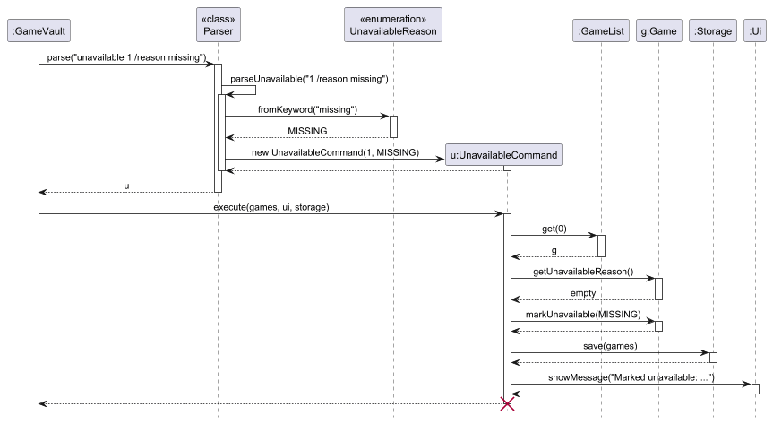

1. `UnavailableCommand#execute(...)` checks that game 1 exists, then gets it from the `GameList`.
2. It gets the game's current reason. If it is already `MISSING`, it reports this and saves nothing.
3. Otherwise it calls `Game#markUnavailable(MISSING)`, which also replaces any other reason, and saves the
   collection with `Storage#save(...)`.
4. It shows the game (with its new reason), the old reason if there was one, and how to make it available again.

`AvailableCommand#execute(...)` works the same way, but rejects a game that is not marked unavailable, since that is
most likely the wrong `INDEX`.

**Leaving unavailable games out of suggestions.** `Game#isAvailable()` returns
`!isLent() && !isMarkedUnavailable()`. `filter`, `filter /tag` and `pick` already keep only games for which
`isAvailable()` is true (see [Lending games to friends](#lending-games-to-friends)), so they leave unavailable games
out without any change to those commands.

**Storage.** The reason is saved in the named field `unavailable`, e.g. `Catan | 3 | 4 | 60 |  | unavailable=missing`,
and read back by `GameDecoder#decodeUnavailableReason(...)`. Available games have no such field, so older data files
still load. Because `EditCommand` builds a new `Game` when editing, it copies the old game's reason into the new one.

#### Design considerations

**Aspect: How to store the reason**

* **Alternative 1 (current choice):** An enum of fixed reasons.
  * Pros: Typos such as `misisng` are caught, and each reason can have a friendlier description.
  * Cons: Adding a reason needs a code change.
* **Alternative 2:** Free text, e.g. `/reason left at Alex's house`.
  * Pros: Users can write anything.
  * Cons: Nothing can be checked, and the text must be kept free of the `|` used in the data file.

**Aspect: Lent-out games**

Lent-out games are handled by the `lend` command, which also records who has the game, so `lent` is not one of the
reasons here. Both features leave a game out of `filter` and `pick` through one shared check, `Game#isAvailable()`,
rather than each adding its own, so the suggestion commands cannot disagree about which games can be played.

**Aspect: Marking an unavailable game again with a different reason**

* **Alternative 1 (current choice):** Replace the reason, and show the old one.
  * Pros: One step when, for example, missing pieces turn out to be damage.
  * Cons: The old reason is lost.
* **Alternative 2:** Reject it until the game is made available first.
  * Pros: Changes are always deliberate.
  * Cons: An extra command for a common case.

#### Possible future improvements

* An optional note, e.g. which pieces are missing.
* A way to list only the unavailable games.
* Name unavailable games in the note that `filter` and `pick` add, as is already done for lent games
  (`GameList#describeLeftOut(...)` currently names lent games only).

<!-- @@author yy261 -->
### Filtering games by player count and play time

The `filter` command answers the question a host asks on game night: *which of my games can this many people play
in the time we have?* For example, `filter 4 /time 45` shows the games for 4 players that take 45 minutes or less.

The feature involves these classes:

* `Parser` turns the user's input into a `FilterCommand`.
* `FilterCommand` holds the player count and the optional conditions (time limit, difficulty level and how recently
  the game may have been played), and shows the results.
* `GameList` picks out the matching games, asking each `Game` whether it fits.
* `Game` stores an optional play time and knows whether it fits a player count (`fitsPlayerCount`), a time
  limit (`fitsTime`) and whether it can be played tonight (`isAvailable`, i.e. not lent out or marked unavailable).

The sequence diagram below shows what happens when the user enters `filter 4 /time 45`.

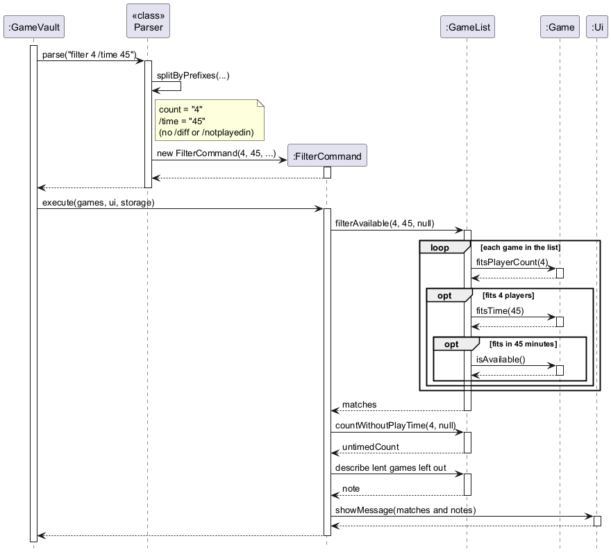

1. `GameVault` passes the input to `Parser#parse(...)`, which sees the command word `filter` and calls
   `Parser#parseFilter(...)`.
2. `parseFilter` uses `Parser#splitByPrefixes(...)` to split the arguments into the text before the first prefix
   (the player count, `4`) and the text after each prefix (`/time` → `45`). Both are checked to be whole numbers of
   at least 1. The optional `/diff` and `/notplayedin` parts are read in the same way (see
   [Difficulty levels](#difficulty-levels) and [Showing when games were last played](#showing-when-games-were-last-played));
   here they are not given, so the `FilterCommand` has no level and no day limit.
   (If `/tag` is given instead, a `FilterTagCommand` is created; see the tagging feature.)
3. `GameVault` calls `FilterCommand#execute(...)`, which asks `GameList#filterAvailable(4, 45, null)` for the
   matching games. A game matches if `Game#fitsPlayerCount(4)`, `Game#fitsTime(45)` and `Game#isAvailable()` are all
   true (`null` means any difficulty level). The order of the collection is kept, and the collection itself is not
   changed.
4. `FilterCommand` then calls `GameList#countWithoutPlayTime(4, null)` to count the available games that fit 4 players
   but were left out only because they have no play time recorded. It also asks `GameList` for a note naming any lent
   games that would otherwise have matched (see [Lending games to friends](#lending-games-to-friends)).
5. `FilterCommand` passes the matches and any notes to `Ui#showMessage(...)`:

```
Games that fit 4 players in 45 minutes or less:
  Love Letter (2-4 players, 20 min)
(1 game(s) for 4 players were left out because they have no play time recorded.)
```

**How play time is stored.** `Game` keeps the play time in an `int` field, where `0` means "not recorded".
`Game#hasPlayTime()` hides this detail from other classes, and `Game#fitsTime(...)` returns false for a game with
no play time. In the data file, the time is an optional fourth field (see [Storage](#saving-and-loading-games-storage)),
so files saved before play time was added still load.

**How prefixes are found.** `Parser#splitByPrefixes(...)` treats a prefix such as `/time` as a prefix only when it is
a separate word, i.e. it has a space (or the start or end of the input) on both sides. This means:

* the prefixes can be given in any order, e.g. `add Catan /time 60 /max 4 /min 3`,
* a title such as `Foo/minimal` is not split at `/min`, and
* giving the same prefix twice (e.g. `filter 4 /time 30 /time 60`) is rejected with a clear error,
  instead of one of the values being silently ignored, and
* prefixes are not case-sensitive, like command words, so `/TIME 30` works the same as `/time 30`. The pattern is
  built with `Pattern.CASE_INSENSITIVE`, and each prefix found is stored in lower case so callers can look it up with
  the prefix constants. Each prefix is wrapped in `Pattern.quote(...)`, so it is matched literally.

The same method is used by every command that takes prefixes (`add`, `edit`, `filter`, `pick`, `lend`, `log`,
`unavailable` and `borrow`), so all commands follow the same rules.

#### Design considerations

**Aspect: Games with no play time recorded, when a time limit is given**

* **Alternative 1 (current choice):** Leave them out, and tell the user how many were left out.
  * Pros: Every game shown is known to fit, so the host can trust the list.
    The note explains why a game the user expected is missing.
  * Cons: A short game is hidden until its play time is recorded.
* **Alternative 2:** Include them, since they *might* fit.
  * Pros: No game is hidden.
  * Cons: The host may pick a 3-hour game for a 45-minute slot, which is exactly what the feature is meant to prevent.

We chose Alternative 1 because a time filter that shows games that might not fit would not be useful.
The note keeps it from feeling like games have disappeared.

**Aspect: How to represent "no play time" in `Game`**

* **Alternative 1 (current choice):** An `int` field where `0` means "not recorded", hidden behind `hasPlayTime()`.
  * Pros: Simple. A real play time is always at least 1 minute, so `0` can never be mistaken for a real value.
  * Cons: Code inside `Game` must remember to check for `0`.
* **Alternative 2:** An `Integer` field that is `null` when not recorded, or an `OptionalInt`.
  * Pros: "Not recorded" is stated explicitly in the type.
  * Cons: Every use has to handle `null` or unwrap the optional, which adds clutter for little benefit.

Because only `Game` reads the field directly, Alternative 1 keeps the rest of the code simple. The `0` value never
leaves the class except through the data file, where a missing field is used instead.

**Aspect: Separate commands for each kind of filter vs. one `filter` command**

* **Alternative 1 (current choice):** One `filter` command with optional `/time` and `/tag` parts.
  * Pros: Users only need to learn one command, and can combine conditions, e.g. `filter 4 /time 45 /tag party`.
  * Cons: `parseFilter` has to decide which form was used.
* **Alternative 2:** Separate commands such as `filtertime` and `filtertag`.
  * Pros: Each command is simpler to parse.
  * Cons: Conditions cannot be combined, and there are more command words to remember.

#### Possible future improvements

* Accept a range such as `/time 30-60` for games whose length varies a lot.

### Lending games to friends

Hosts often lend games to friends, and a game that is lent out cannot be played tonight. The `lend`, `return` and
`lentout` commands record who has which game, and `filter` and `pick` leave lent games out of their suggestions.

The state diagram below shows the two states a game can be in, and which commands move it between them.

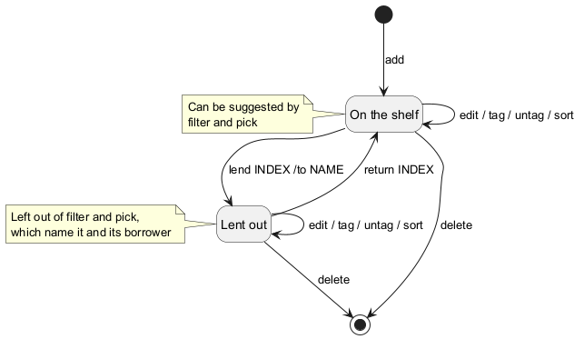

**How lending is stored.** `Game` has a `borrower` field holding the borrower's name, or `null` when the game is on
the shelf. Like tags, lending is changed in place through `Game#lendTo(...)` and `Game#markReturned()`, and read
through `Game#isLent()` and `Game#getBorrower()`. The rules for a name (1 to 30 characters, no `|`) are kept in the
small `Borrower` class, so that `Parser` and `GameDecoder` accept exactly the same names, in the same way that `Tag`
holds the rules for tags. In the data file, the borrower is saved as a named field, e.g.
`Hive | 2 | 2 |  |  | lent=Alice`, which `Game#getNamedFileFields()` writes and `GameDecoder#decodeNamedField(...)`
reads. A game that is not lent has no `lent` field, so it is saved exactly as before.

**Lending a game.** The sequence diagram below shows what happens when the user enters `lend 2 /to Alice`.

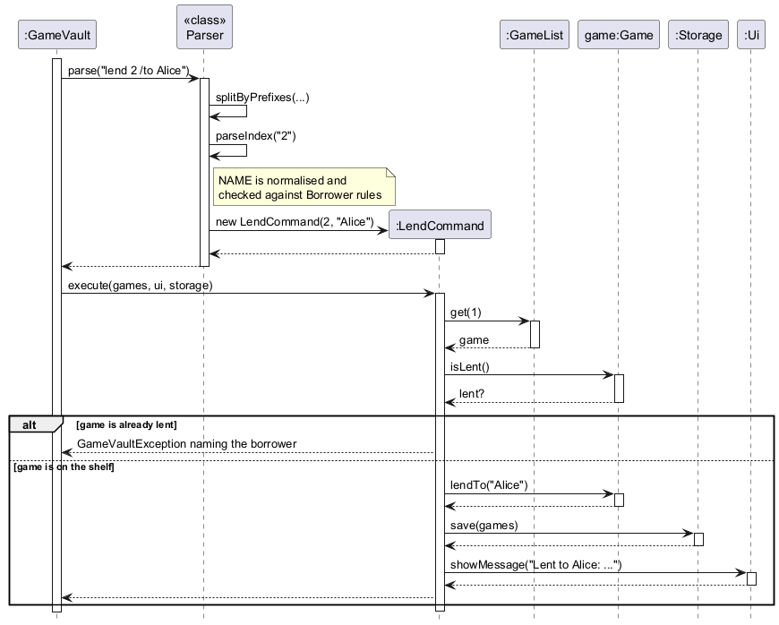

1. `Parser#parseLend(...)` uses `splitByPrefixes(...)` to split the input into the index (`2`) and the name after
   `/to` (`Alice`). The index is checked by `parseIndex(...)`, shared with `delete` and `edit`.
   The name is normalised with `Borrower#normalise(...)` (extra spaces removed) and checked with
   `Borrower#isValid(...)`.
2. `LendCommand#execute(...)` checks that a game with that number exists, then gets it from the `GameList`.
3. If the game is already lent, a `GameVaultException` names the current borrower and tells the user to `return` it
   first. The earlier borrower is kept, because lending a game that is already out is most likely a mistake,
   e.g. the wrong index.
4. Otherwise, `Game#lendTo(...)` records the borrower, `Storage#save(...)` writes the collection to the data file,
   and `Ui` confirms the change.

`ReturnCommand` works the same way in reverse: it checks that the game is lent, calls `Game#markReturned()` and saves.
`ListLentCommand` goes through the list and shows each lent game with its number from `list`, so the user can use that
number with `return` straight away.

**Leaving lent games out of suggestions.** `Game#isAvailable()` is the one check for whether a game can be
suggested. `filter`, `pick` and `GameList#countWithoutPlayTime(...)` use `GameList#filterAvailableByPlayers(...)` and
`GameList#filterAvailableByPlayersAndTime(...)`, which keep only available games. `FilterTagCommand` calls
`Game#isAvailable()` in its own loop. `GameList#filterByPlayers(...)` still returns every game that fits, for
features that need all games for a group size.
To explain why a game is missing, `filter` and `pick` append the note from
`GameList#describeLeftOut(count, minutes, verb)`, which looks up the lent games that *would* have matched, e.g.
`(Not shown because they are lent out: Catan (to Alice))`. `FilterTagCommand` matches by tag, so it collects its own
list and passes it to `GameList#describeLeftOut(lentGames, verb)`. A lent game that would not have matched anyway
(e.g. one that takes too long) is not mentioned. `EditCommand` builds a new `Game`, so it copies the borrower to the
edited game, just as it copies the tags.

#### Design considerations

**Aspect: How to record that a game is lent**

* **Alternative 1 (current choice):** A nullable `borrower` name in `Game`.
  * Pros: One field answers both "is it lent?" and "who has it?", and the borrower is shown wherever the game is.
  * Cons: Code that uses the name must check `isLent()` first.
* **Alternative 2:** A boolean `isLent` flag, with no name.
  * Pros: Slightly simpler.
  * Cons: The host still has to remember who has the game, which is the main reason to record it.

**Aspect: What `filter` and `pick` do with lent games**

* **Alternative 1 (current choice):** Leave them out, and name them with their borrowers in a note.
  * Pros: Suggestions only include games the host can play tonight, and the note explains a missing game.
  * Cons: Commands need an extra call to find the lent games for the note.
* **Alternative 2:** Show them, marked as lent.
  * Pros: Simpler, since the filtering does not change.
  * Cons: `pick` could choose a game that is not on the shelf, which defeats the purpose of picking.

**Aspect: Where lent games are skipped**

Skipping lent games inside the `GameList#filterAvailable...` methods, instead of in each command, means `filter`,
`pick` and the count of untimed games cannot disagree about which games are available. A new reason for a game to be
unavailable only needs a change to `Game#isAvailable()`. Keeping `GameList#filterByPlayers(...)` general means
other features can still find every game for a group size. `list`, `find` and `sort` use the whole list, so they
still show lent games, with `(lent to NAME)` after each one.

#### Possible future improvements

* Record when a game was lent, and a due date, so `lentout` can show overdue games first.
* Let the user mark a game as unavailable for other reasons, such as missing pieces, with the same effect on
  `filter` and `pick`.

### Difficulty levels

A host choosing a game for new players needs to avoid anything too complicated. Each game can therefore record how
hard it is, with `/diff easy|medium|hard` on `add` and `edit`, and `filter` and `pick` can use `/diff` to consider only
games at that level, e.g. `filter 4 /time 45 /diff easy`.

**Model.** The levels are an enum, `Difficulty` (`EASY`, `MEDIUM`, `HARD`). Each value holds the keyword the user types,
which is also how it is written in the data file. `Difficulty#fromKeyword(...)` finds a level by keyword, ignoring
case, so `Parser` and `GameDecoder` accept exactly the same words. `Game` has a `difficulty` field, which is `null` when
no level has been recorded, set through `Game#setDifficulty(...)`. `Game#fitsDifficulty(...)` returns false for a game
with no level, in the same way that `Game#fitsTime(...)` does for a game with no play time.

**Parsing.** `add`, `edit`, `filter`, `pick` and the `/tag` form of `filter` all pass `/diff` to
`Parser#splitByPrefixes(...)` and read the value with `Parser#parseOptionalDifficulty(...)`, which returns `null` if
`/diff` was not used, so every command gives the same error messages. Only `edit` accepts `/diff none`, which removes
the level. `EditCommand` builds a new `Game`, so it copies the old level unless a new one was given or it was removed.

**Storage.** The level is saved as the named field `difficulty`, e.g. `Catan | 3 | 4 | 60 |  | difficulty=easy`, which
`Game#getNamedFileFields()` writes and `GameDecoder#decodeNamedField(...)` reads. A game with no level has no such
field, so older data files still load and are saved unchanged.

**Filtering.** `FilterCommand` and `PickCommand` call `GameList#filterAvailable(count, minutes, difficulty)`, which
applies all the conditions in one place. A `null` difficulty means any level. The notes that explain why a game is
missing take the level into account too, so that the user is only told about games that could have matched.
The activity diagram below shows what happens to one game for `filter 4 /diff easy`.

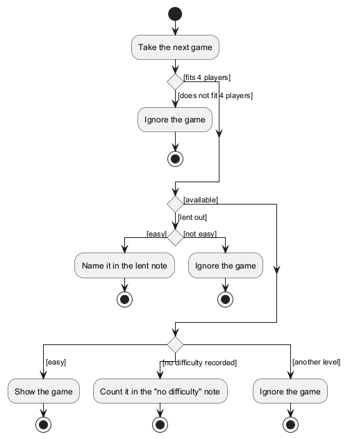

* `GameList#describeNoDifficulty(...)` counts the available games that were left out only because they have no level.
  Games that would not have fitted the time limit anyway are not counted.
* `GameList#countWithoutPlayTime(count, difficulty)` no longer counts an untimed game that is known to be at another
  level. An untimed game with no level is counted in both notes, as recording either detail alone would not be enough.
* `GameList#describeLeftOut(count, minutes, difficulty, verb)` only names lent games at the requested level.

#### Design considerations

**Aspect: How to store the level**

* **Alternative 1 (current choice):** An enum of three fixed levels.
  * Pros: Typos such as `esay` are caught, and `filter` can compare levels exactly.
  * Cons: Adding a level needs a code change.
* **Alternative 2:** A number, e.g. the 1 to 5 complexity ratings used on board game websites.
  * Pros: Finer-grained, and could support a range.
  * Cons: Hosts would have to agree what each number means, while `easy` is clear to everyone.

**Aspect: Games with no difficulty recorded, when `/diff` is given**

* **Alternative 1 (current choice):** Leave them out, and say how many were left out.
  * Pros: Every game shown is known to be at that level, and this matches how `/time` treats games with no play time.
  * Cons: A suitable game stays hidden until its level is recorded.
* **Alternative 2:** Include them, as they might be at that level.
  * Pros: No game is hidden.
  * Cons: A host could be offered a very complicated game for a group of new players, which the feature should prevent.

**Aspect: Whether `/diff` works without a player count**

`filter` still needs `COUNT`, except in its `/tag` form. Keeping `COUNT` required means `FilterCommand` always has a
group size to work with, and every game shown can actually be played by the group.

#### Possible future improvements

* `sort difficulty`, to list the easiest games first.
* Accept more than one level, e.g. `/diff easy medium`.
<!-- @@author KRAZYZECTRON -->
### Recording who lent or gave a game

The `borrow` command records who a game came from, and optionally when it must be given back, e.g.
`borrow 2 /from Bob /due 2026-11-10`. `giveback 2` removes a borrowed game once it has been given back.
`list` shows the record after the game, e.g.
`Hive (2 players) (borrowed from Bob, due 2026-11-10)`, and ends with a reminder of any overdue games.
This is the opposite direction to `lend` (see [Lending games to friends](#lending-games-to-friends)).

**Model.** Each `Game` has two more fields: `lender`, the person the game is from, and `dueBack`, a `LocalDate`.
Both are `null` when not recorded, and `dueBack` is also `null` for a game that does not have to be given back,
such as a gift. `Game#recordLender(name, dueBack)` sets both together, and `Game#getDueBack()` returns an
`Optional`. `Game#isOverdue(today)` is true only when the due-back date is before
`today`, so a game due back today is not overdue yet. Lender names follow the same rules as borrower names in
`lend`, so both reuse the `Borrower` class.

**Parsing.** `Parser#parseBorrow(arguments, today)` uses `splitByPrefixes(...)` to read `INDEX`, `/from` and the
optional `/due`. Today's date is passed in (`LocalDate.now()` in normal use), as in `log`, so that the rule
"not in the past" can be unit-tested with a fixed date. `Parser#parseGiveBack(...)` only reads `INDEX`.

**Executing.** The sequence diagram below shows `borrow 2 /from Bob /due 2026-11-10`.

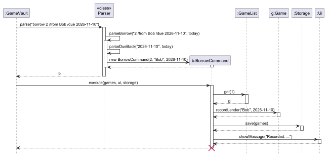

1. `BorrowCommand#execute(...)` checks that game 2 exists, then gets it from the `GameList`.
2. It compares the game's current record with the new one. If they are the same, it reports this and changes
   nothing, so the error case never touches the game.
3. Otherwise it calls `Game#recordLender("Bob", 2026-11-10)` and saves with `Storage#save(...)`.
4. It shows the game, the old record if there was one, and how to use `giveback` once the game is given back.

`GiveBackCommand#execute(...)` rejects a game that has no lender, since that is most likely the wrong `INDEX`, and
a gift (a lender but no due-back date), since there is nothing to give back. Otherwise it removes the game with
`GameList#delete(...)` and saves, because a game that has gone back to its owner is no longer on the user's shelf.

**Overdue reminder.** `ListCommand` takes today's date (again `LocalDate.now()` in normal use, and a fixed date in
tests). After the numbered list, it adds a line for each game where `Game#isOverdue(today)` is true, using the same
numbers as the list, so the user can run `giveback` straight away.

**Storage.** The record is saved in two named fields, `from` and `due`, e.g.
`Hive | 2 | 2 |  |  | from=Bob | due=2026-11-10`. Named fields can come in any order in a hand-edited file, so
`GameDecoder` reads them separately (`due` through `Game#setDueBack(...)`), and only checks that `due` has a
matching `from` once the whole line is read. Past due-back dates are accepted when loading, since a game that was
not given back in time is simply overdue. `EditCommand` copies the record into the edited game.

#### Design considerations

**Aspect: Effect on suggestions**

* **Alternative 1 (current choice):** Borrowed games stay available, so `filter` and `pick` still suggest them.
  * Pros: A borrowed game is on the user's shelf, so it can be played, and borrowing a game is often done so it can
    be played at game night.
  * Cons: None for now. A later option could prefer borrowed games in `pick`, so they are played before going back.
* **Alternative 2:** Leave borrowed games out, like lent games.
  * Pros: Treats every "lending" record the same way.
  * Cons: Hides games the user has and can play.

**Aspect: What `giveback` does with the game**

* **Alternative 1 (current choice):** Remove the game from the collection.
  * Pros: The game is no longer on the shelf, so `filter` and `pick` stop suggesting it, with nothing more to do.
  * Cons: Its play history and ratings are lost, so borrowing it again starts afresh.
* **Alternative 2:** Keep the game, but clear the record and mark it unavailable.
  * Pros: Keeps its history and ratings.
  * Cons: The collection fills up with games the user does not own, and "unavailable" suggests the game is
    the user's own but cannot be played right now.

**Aspect: Where the overdue reminder is shown**

* **Alternative 1 (current choice):** At the end of `list`.
  * Pros: `list` is the command users run most often, so the reminder is seen without remembering another command.
  * Cons: `list` depends on today's date, so it needs a constructor that tests can give a fixed date.
* **Alternative 2:** A separate command, e.g. `overdue`.
  * Pros: `list` stays the same.
  * Cons: Users who forget the game is borrowed will also forget to run the command.

**Aspect: Due dates in the past**

The `borrow` command rejects a due-back date in the past, since it is most likely a typo, such as the wrong year.
`GameDecoder` accepts them, as a past due-back date in the data file just means the game is overdue.

#### Possible future improvements

* Show overdue games in the welcome message, so they are seen as soon as GameVault starts.
* A command that lists only borrowed games, like `lentout` does for lent games.
<!-- @@author -->


## Product scope
### Target user profile

GameVault is for people who regularly host board game or card game nights, for friends, family or a CCA, and who:

* own a collection of games that is too large to remember in detail (typically 10 to a few hundred games),
* often have to choose a game quickly for a group whose size and available time change from night to night,
* lend games to friends, borrow games from them, and sometimes have games with missing pieces,
* prefer typing to clicking, and are comfortable with a command-line app.

### Value proposition

When a group arrives, the host has to work out which games suit the number of people, the time available and how
experienced the players are, while remembering which games are lent out, damaged or played too recently.
GameVault keeps all of this in one place and answers the question in a single command, e.g.
`filter 6 /time 45 /diff easy` or `pick 6`, which is faster than checking the boxes on a shelf. It also keeps a
history of what was played and what the group enjoyed, so suggestions improve over time.

## User Stories

Priorities: `* * *` = must have, `* *` = nice to have, `*` = unlikely to have.

|Version|Priority| As a ... | I want to ... | So that I can ...|
|--------|--------|----------|---------------|------------------|
|v1.0|`* * *`|new user|see usage instructions|refer to them when I forget how to use the application|
|v1.0|`* * *`|host|add a game with the number of players it supports|build up my collection in the app|
|v1.0|`* * *`|host|list all my games|see what I own at a glance|
|v1.0|`* * *`|host|delete a game|remove games I no longer own|
|v1.0|`* * *`|host|find the games that fit the number of people who turned up|choose a game that everyone can play|
|v1.0|`* * *`|host|have my collection saved automatically|keep it between sessions without doing anything extra|
|v1.0|`* *`|host who edits the data file by hand|be told which lines are invalid instead of losing the whole file|fix my mistakes easily|
|v2.0|`* * *`|host with little time|record how long each game takes and filter by time|pick a game that fits the time we have|
|v2.0|`* * *`|host|edit a game's details|correct mistakes without deleting and re-adding the game|
|v2.0|`* *`|host with a large collection|find a game by part of its title|locate it without going through the entire list|
|v2.0|`* *`|host with many games|sort my collection by title, player count or play time|scan it more easily|
|v2.0|`* *`|host|tag games (e.g. `party`, `strategy`) and filter by tag|find the kind of game the group is in the mood for|
|v2.0|`* *`|host with many tags|see all the tags in use|filter by one without guessing its name|
|v2.0|`* *`|indecisive host|have the app pick a random game that fits the group|stop spending time deciding|
|v2.1|`* * *`|host who runs regular game nights|log each play session|keep my play history accurate|
|v2.1|`* *`|host who runs regular game nights|see how long it has been since each game was last played|avoid repeating games the group just played|
|v2.1|`* *`|host who wants variety|hide games played recently when filtering|stop the group from repeating the same game|
|v2.1|`* *`|host who logs game nights|view a game's full play history|see how popular it has been|
|v2.1|`* *`|host with games that rarely get played|see which games have never been played|give underused games a fair chance|
|v2.1|`* *`|host with new players|record each game's difficulty and filter by it|avoid games that are too complicated for them|
|v2.1|`* *`|host whose group has favourites|rate a game after playing it|have `pick` suggest games the group enjoyed more often|
|v2.1|`*`|host who rated a game by mistake|undo a rating|keep `pick` accurate|
|v2.1|`* *`|host who lends games to friends|record who has a game|know who to ask for it back, and not be offered it while it is away|
|v2.1|`* *`|host who lends games to friends|see all the games that are lent out|know who to ask for each one|
|v2.1|`* *`|host with damaged games|mark a game as unavailable (e.g. missing pieces)|not be offered a game we cannot play|
|v2.1|`*`|host who borrows games|record who lent me a game and when it is due back|give it back on time|
|v2.1|`*`|host who receives games as gifts|record who gave me a game|know who to thank|

## Non-Functional Requirements

1. GameVault should work on any mainstream OS (Windows, macOS, Linux) that has Java 25 installed.
1. GameVault should work without an internet connection, since all data is kept in a local file.
1. GameVault should respond to any command within 1 second for a collection of up to 1000 games.
1. A user who types at a normal speed should be able to choose a game faster with GameVault than by
   looking through their shelf.
1. The data file should be a plain text file that a user can read and edit by hand, and a mistake in one line
   should not stop the other games from loading.
1. Saved data should not be lost if GameVault is closed with `exit` or the terminal is closed after a command
   finishes, since every change is saved immediately.
1. GameVault should be a single JAR file that runs without being installed.

## Glossary

* *Mainstream OS* - Windows, Linux, Unix, macOS.
* *Collection* - all the games the user has added to GameVault.
* *INDEX* - the number shown next to a game in `list`, starting from 1, which other commands use to refer to that game.
* *Play time* - how many minutes one round of a game usually takes.
* *Play session* - one occasion on which a game was played, recorded with `log` (a date and the number of players).
* *Available game* - a game that is on the user's shelf and can be played: not lent out and not marked unavailable.
  Only available games are suggested by `filter` and `pick`.
* *Lent game* - a game the user has lent to someone else (`lend`).
* *Borrowed game* - a game someone else has lent to the user (`borrow ... /due DATE`).
* *Overdue* - a borrowed game whose due-back date is before today.
* *Data file* - `data/games.txt`, where GameVault saves the collection, one game per line.
* *Named field* - a `KEY=VALUE` part of a line in the data file, e.g. `lent=Alice`, used for optional data such as
  play sessions, ratings, difficulty, availability and who has the game.

## Instructions for manual testing

Given below are instructions to test the app manually. These instructions only provide a starting point for
testers; testers are expected to do more exploratory testing.

### Launch and shutdown

1. Initial launch
   1. Put `gamevault.jar` in an empty folder.
   1. Open a terminal in that folder and run `java -jar gamevault.jar`.<br>
      Expected: The welcome message is shown. A `data` folder containing an empty `games.txt` is created.
1. Shutdown
   1. Type `exit`.<br>
      Expected: A goodbye message is shown and the app closes.

### Viewing help

1. Test case: `help`<br>
   Expected: Every command is listed with a one-line description and its format.

### Loading sample data

1. Close GameVault, then replace the contents of `data/games.txt` with:
   ```
   Catan | 3 | 4 | 60 | strategy | difficulty=medium
   Codenames | 4 | 8 | 15 | party,word | difficulty=easy
   Hive | 2 | 2 | 20 |  | sessions=2026-10-25@2
   Azul | 2 | 4 | 45 | family | ratings=3/0
   Werewolf | 8 | 18 |  | party
   ```
1. Launch GameVault and enter `list`.<br>
   Expected: All 5 games are listed, numbered 1 to 5, with their details.

### Adding, editing and deleting a game

1. Test case: `add Uno /min 2 /max 10 /time 20 /diff easy /tag party`<br>
   Expected: Uno is added and the number of games is shown.
1. Test case: `add Chess /min 2`<br>
   Expected: No game is added. An error shows the correct format.
1. Test case: `add Chess /min 3 /max 2`<br>
   Expected: No game is added. An error says MAX cannot be less than MIN.
1. Test case: `edit 1 /max 6 /time none`<br>
   Expected: Catan now supports 3-6 players and has no play time. Its tags and difficulty are kept.
1. Test case: `delete 0`, then `delete 99`<br>
   Expected: No game is deleted. Each shows an error about the INDEX.

### Finding a game for the group

1. Test case: `find cat`<br>
   Expected: Catan is shown with its number from `list` (1).
1. Test case: `find xyz`<br>
   Expected: A message says no games have `xyz` in the title.
1. Test case: `filter 4`, then `filter 4 /time 30`, then `filter 4 /diff easy`<br>
   Expected: Only games that fit all the given conditions are shown, with notes about games left out because they
   have no play time or difficulty recorded.
1. Test case: `filter /tag party`<br>
   Expected: Codenames and Werewolf (and Uno, if added) are shown.
1. Test case: `pick 4` several times<br>
   Expected: A random game for 4 players is suggested each time. Over many tries, Azul (rated `+3/-0`) is likely
   to come up more often than the others.
1. Test case: `pick 30`<br>
   Expected: A message says no game fits.

### Lending, borrowing and unavailable games

1. Test case: `lend 2 /to Alice`, then `filter 4`<br>
   Expected: Codenames is not shown, and a note says it is lent to Alice.
1. Test case: `lentout`<br>
   Expected: Codenames is listed with its number from `list` (2), lent to Alice.
1. Test case: `return 2`, then `lentout`<br>
   Expected: Codenames is back, and `lentout` says none of the games are lent out. `filter 4` shows it again.
1. Test case: `unavailable 1 /reason missing`, then `pick 3` several times<br>
   Expected: Catan is never picked. `list` shows `(unavailable: missing pieces)`. `available 1` undoes this.
1. Test case: `unavailable 1 missing`<br>
   Expected: An error asks whether `/reason` was forgotten.
1. Test case: `borrow 6 /from Bob /due 2020-01-01` (game 6 is the Uno added earlier)<br>
   Expected: An error says the date cannot be in the past.
1. Test case: `borrow 6 /from Bob /due` followed by a date a few days from today, then `giveback 6`<br>
   Expected: Uno is recorded as borrowed, then removed from the collection when given back.
1. Test case: `borrow 5 /from Mary Tan`, then `giveback 5`<br>
   Expected: Werewolf is recorded as a gift from Mary Tan, and `giveback` refuses, since there is nothing to give back.
1. To test the overdue reminder, close GameVault, add ` | from=Bob | due=2020-01-01` to the end of a line in
   the data file that already has a TAGS field (e.g. the Catan line), and launch GameVault again.<br>
   Expected: `list` ends with a reminder that Catan is overdue.

### Play history and ratings

1. Test case: `log 3 /players 2`, then `history 3`<br>
   Expected: Hive's history shows two sessions, the newest dated today.
1. Test case: `log 3 /players 5`<br>
   Expected: An error says Hive cannot be played by 5 players.
1. Test case: `unplayed`<br>
   Expected: Every game with no logged session is listed. Each game keeps its number from `list`, so Hive (3) is
   skipped and the numbers go 1, 2, 4, 5.
1. Test case: `filter 2`, then `filter 2 /notplayedin 1`<br>
   Expected: The first shows Hive and Azul. The second shows only Azul, with a note that 1 game was left out
   because it was played in the last 1 day(s).
1. Test case: `rate 1 up`, then `unrate 1 up`<br>
   Expected: Catan's rating goes to `+1/-0`, then back to `+0/-0`.

### Tags and sorting

1. Test case: `tag 4 strategy co-op`<br>
   Expected: Azul now has the tags `co-op`, `family` and `strategy`.
1. Test case: `tag 4 strategy`<br>
   Expected: An error says Azul is already tagged `strategy`.
1. Test case: `tags`<br>
   Expected: Every tag in use is listed in alphabetical order with its number of games, e.g. `strategy (2 game(s))`.
1. Test case: `untag 4 co-op`, then `untag 4 co-op` again<br>
   Expected: The first removes the tag. The second shows an error saying Azul does not have it.
1. Test case: `sort players`, then `sort time`, then `sort title`<br>
   Expected: Each time, the collection is shown in the new order: fewest players first (Hive first), shortest play
   time first with Werewolf (no play time) last, then A to Z. `list` keeps the last order.
   Sorting changes the numbers of the games, so do this after the other tests that use game numbers.

### Saving data

1. Dealing with a corrupted data file
   1. Close GameVault and change one line of `data/games.txt` to `Catan | three | 4`.
   1. Launch GameVault.<br>
      Expected: A warning says which line was skipped and why. All the other games load normally.
1. Dealing with a missing data file
   1. Close GameVault and delete `data/games.txt`.
   1. Launch GameVault.<br>
      Expected: GameVault starts with an empty collection and creates a new `games.txt`.