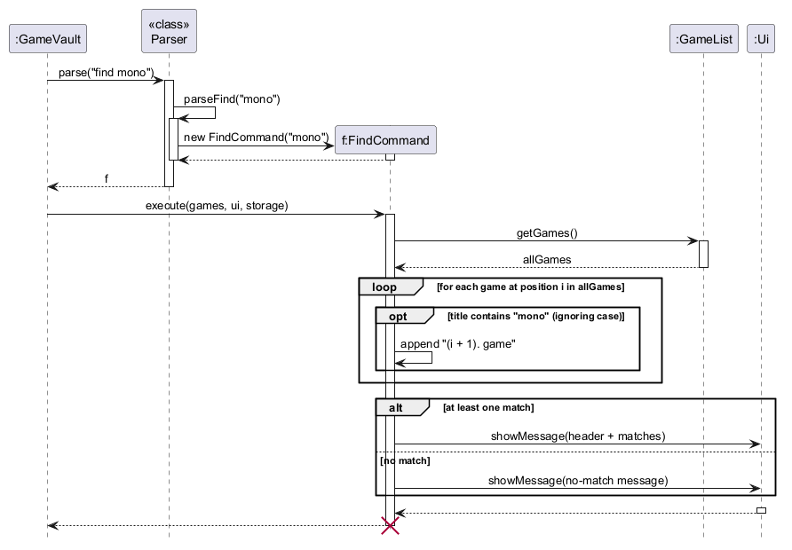
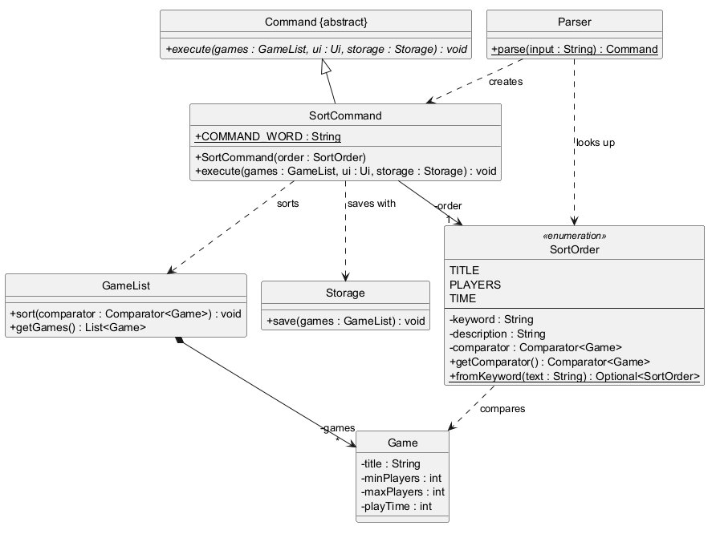
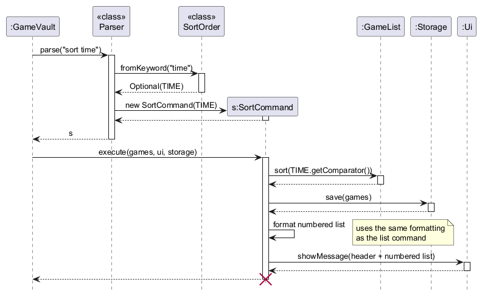
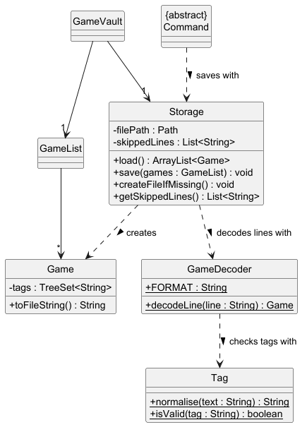
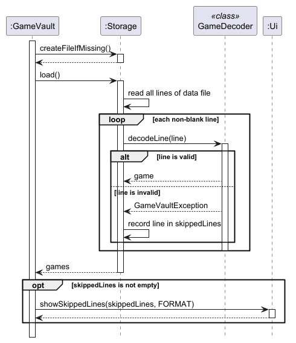
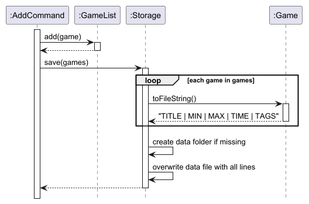
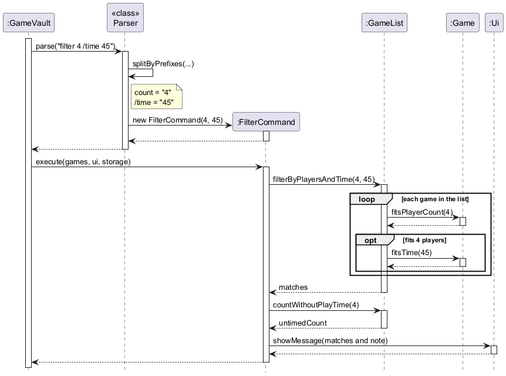

# Developer Guide

## Acknowledgements

{list here sources of all reused/adapted ideas, code, documentation, and third-party libraries -- include links to the original source as well}

## Design & implementation
### Edit feature

The edit feature lets the user change a game's title and/or player range without deleting and re-adding it.

**Parsing.** `Parser#parseEdit` splits the arguments just before each field prefix (`/title`, `/min`, `/max`),
so the fields can be given in any order. The first part is the `INDEX`, which is checked by `Parser#parseIndex`
(shared with `delete`). Each field is then checked on its own, e.g. `MIN` must be a whole number of at least 1,
and `TITLE` must not contain `|`. A field that is not given is passed to `EditCommand` as `null`,
meaning "keep the current value".

**Execution.** `EditCommand#execute` first checks that a game with that number exists. It then builds the new game,
taking each given field and falling back to the existing game's value for any field that was not given. Only then is
`MAX >= MIN` checked, because this rule depends on the game's current values (e.g. `edit 1 /min 5` must fail if the
game's current maximum is 4). If the check passes, `GameList#set` replaces the game at the same position and
`Storage#save` writes the updated collection to the data file.

**Design considerations.**
* *Where to check MIN/MAX:* the parser does not have access to the game list, so it cannot know the game's
  existing values. The check is therefore done in `EditCommand`, in the same way that `DeleteCommand` checks
  whether the index exists when it runs.
* *Replace in place vs. delete and re-add:* replacing keeps the game's number in `list` unchanged,
  which is less confusing for the user.

<!-- @@author SwaggyDaddy67 -->
### Find feature

The find feature lets the user locate games by part of their title, e.g. `find mono` shows "Monopoly", without
scrolling through the whole collection. Each result is shown with its number from `list`, so the user can pass it
straight to `delete`, `edit` or `tag`.

**Parsing.** `Parser#parse` recognises the `find` command word and calls `Parser#parseFind`, which trims the rest of
the input and uses it as the keyword. The whole remaining text is one keyword, so `find ticket to` looks for the
phrase "ticket to" rather than two separate words. An empty keyword is rejected with a `GameVaultException` that shows
the correct format. Otherwise, a `FindCommand` holding the keyword is returned.

**Execution.** The sequence diagram below shows what happens when the user enters `find mono`.



1. `FindCommand#execute` gets a read-only view of the collection from `GameList#getGames()`.
2. It lower-cases the keyword once, then goes through the games **by position**. For each game whose lower-cased title
   contains the keyword, it adds a line made of the game's position plus one (the number `list` shows) and the game.
3. If at least one game matched, the header and the matching lines are passed to `Ui#showMessage`. Otherwise,
   a "no games have ... in the title" message is shown instead.

`find` does not change the collection, so it does not call `Storage`.

**Design considerations.**

**Aspect: How results are numbered**

* **Alternative 1 (current choice):** Show each match with its number from `list`.
  * Pros: The number can be used directly with `delete`, `edit` or `tag`, which is the main reason to search.
  * Cons: Results are not numbered 1, 2, 3, which may look odd at first (e.g. `2.` followed by `5.`).
* **Alternative 2:** Number the results from 1, like a new list.
  * Pros: Looks tidier.
  * Cons: The numbers would not match `list`, so `delete 1` after a search could delete the wrong game.
    This is the reason `filter` and `pick` do not number their results at all.

**Aspect: Where the search happens**

* **Alternative 1 (current choice):** `FindCommand` loops over `GameList#getGames()` itself.
  * Pros: Keeps each game's position available while searching, and needs no change to `GameList`.
* **Alternative 2:** Add a `GameList#findByTitle(keyword)` method that returns the matching games, like
  `GameList#filterByPlayers`.
  * Cons: It would return only the games, losing their positions, so `FindCommand` would have to look each one up
    again to number it.

**Aspect: Matching rule**

We use a case-insensitive "contains" match because users usually remember part of a title but not its exact
spelling or capitalisation. Matching whole words only (e.g. `cat` not finding "Catan") was rejected because it
would make short keywords much less useful.

### Sort feature

The sort feature reorders the whole collection by title, player count or play time, e.g. `sort time`, then saves it
and shows the new numbered list.

The class diagram below shows the classes involved.



* `SortOrder` is an enumeration of the supported orders: `TITLE`, `PLAYERS` and `TIME`. Each value holds the keyword
  the user types (e.g. `time`), a description shown after sorting, and the `Comparator<Game>` that defines the order.
* `SortCommand` holds one `SortOrder` and does the sorting when executed.
* `GameList#sort(Comparator<Game>)` reorders the games in place.

**The three orders.**
* `TITLE`: alphabetical, ignoring case.
* `PLAYERS`: by minimum players, then by maximum players.
* `TIME`: shortest play time first. A game with no play time recorded is treated as taking `Integer.MAX_VALUE`
  minutes, so it always comes after every game whose play time is known.

Games that tie in `PLAYERS` or `TIME` are ordered by title. This makes the result depend only on the games
themselves, not on the order they were in before, so sorting twice gives the same result.

**Parsing and execution.** The sequence diagram below shows what happens when the user enters `sort time`.



1. `Parser#parseSort` looks up the keyword with `SortOrder#fromKeyword`, which ignores case and surrounding spaces
   and returns an empty `Optional` for an unknown keyword. A missing or unknown keyword is rejected with an error that
   lists the valid choices. The list comes from `SortOrder#describeKeywords`, so it stays correct if an order is added.
2. `SortCommand#execute` passes the order's comparator to `GameList#sort`, which uses the stable `List#sort`.
3. The new order is saved with `Storage#save`, so `list` keeps showing it after the app restarts.
4. The sorted games are shown numbered from 1, using `ListCommand#formatNumberedList`, which `list` also uses.
   An empty collection is not sorted or saved; a message is shown instead.

**Adding a new order** only needs a new `SortOrder` value with its keyword, description and comparator.
`Parser`, `SortCommand` and the error messages do not need to change.

**Design considerations.**

**Aspect: Reorder the collection vs. show a sorted view**

* **Alternative 1 (current choice):** Reorder the collection itself and save it.
  * Pros: The order lasts, and the numbers shown after sorting are the real `list` numbers, so they can be used
    with `delete`, `edit` or `tag` straight away.
  * Cons: The user's original order (the order games were added) is lost, and every game's number may change.
    The UG warns about this.
* **Alternative 2:** Show a sorted copy without changing the collection.
  * Pros: Keeps the original order.
  * Cons: The numbers shown would not match `list`, which is the problem the find feature also avoids.

**Aspect: How orders are represented**

* **Alternative 1 (current choice):** An enumeration that pairs each keyword with its comparator.
  * Pros: Only valid orders can exist, and each order's details are kept in one place.
* **Alternative 2:** A `switch` on the keyword inside `SortCommand`.
  * Cons: The keyword list, the descriptions and the comparators would be spread across several places, and adding
    an order would mean changing each of them.

#### Possible future improvements

* Allow a descending order, e.g. `sort time /desc` for the longest games first.
* Keep games in order automatically, so a newly added game goes to its sorted position instead of the end of the list.
* Sort by more than one key, e.g. by player count, then by play time.
<!-- @@author -->

### Loading the data file

When the app starts, `GameVault` calls `Storage#load`, which reads `data/games.txt` line by line. Each non-blank line
is decoded by `GameDecoder#decodeLine`, which expects the format `TITLE | MIN | MAX | TIME`, where `TIME` is
optional (e.g. `Catan | 3 | 4 | 60` or `Catan | 3 | 4`).

**Handling invalid lines.** If a line is invalid (e.g. a missing field, a non-numeric count, or `MAX < MIN`),
`GameDecoder` throws a `GameVaultException` explaining why. `Storage#load` catches it, records the line number and
reason, and moves on to the next line. After loading, `GameVault` shows these via `Ui#showSkippedLines`.
A missing data file is not an error; the app simply starts with an empty collection.

**Design considerations.**
* *Skip the line vs. reject the whole file:* the data file is meant to be human-editable, so one typo should not
  lose the user's entire collection. Skipping only the bad lines keeps every valid game.

### Saving and loading games (Storage)

GameVault keeps the user's game collection between runs by saving it to a plain text file, `data/games.txt`.
This is handled by the `Storage` component in the `seedu.gamevault.storage` package, which has two classes:

* `Storage` reads the data file when the app starts and rewrites it whenever the collection changes.
* `GameDecoder` turns one line of the file back into a `Game`, checking that the line is valid.

Each game is stored on its own line in the format `TITLE | MIN | MAX | TIME | TAGS`, where `MIN` and `MAX` are the
minimum and maximum player counts, `TIME` is the play time in minutes and `TAGS` is the game's tags, separated by
commas. `TIME` and `TAGS` are optional:

* A game with no tags has no `TAGS` field, and `TIME` is left out too if no play time is recorded.
* A game with tags always has `TAGS` as the fifth field, so `TIME` is left blank if there is no play time.

For example:

```
Catan | 3 | 4 | 60
Love Letter | 2 | 4
Azul | 2 | 4 | 45 | family,strategy
Codenames | 4 | 8 |  | party,word
```

The class diagram below shows how these classes relate to the rest of the app.



`GameVault` owns a single `Storage` object, created with the path of the data file. Commands that change the
collection (currently `add`, `delete`, `edit`, `tag`, `untag` and `sort`) receive the same `Storage` object in `Command#execute(...)` and
use it to save. `Storage` depends on `GameDecoder` only for loading; saving uses `Game#toFileString()` directly.
`GameDecoder` uses `Tag` to check each tag in the file with the same rules as tags typed by the user.

#### Loading games at startup

When GameVault starts, `GameVault#loadGames()` asks `Storage` to prepare the data file and then load it.
The sequence diagram below shows what happens.



1. `GameVault` calls `Storage#createFileIfMissing()`, which creates the `data/` folder and an empty
   `games.txt` if they do not exist yet. An existing file is left untouched.
2. `GameVault` calls `Storage#load()`. If the file does not exist (e.g. it could not be created in step 1),
   `load()` returns an empty list, since a new user simply has no games yet.
3. Otherwise, `load()` reads every line of the file. Blank lines are ignored. Each other line is passed to
   `GameDecoder#decodeLine(...)`, which splits it on `|`, trims each part and checks that:
   * there are three to five parts,
   * `TITLE` is not empty,
   * `MIN` and `MAX` are whole numbers of at least 1,
   * `MAX` is not less than `MIN`,
   * `TIME`, if present and not blank, is a whole number of at least 1. A missing or blank `TIME` means no play
     time is recorded, and
   * each tag in `TAGS`, if present, follows the tag rules once `Tag#normalise(...)` has trimmed it and put it in
     lower case, as checked by `Tag#isValid(...)`. Blank entries (e.g. from a trailing comma) and repeated tags
     are ignored.
4. A valid line becomes a `Game`. An invalid line causes `GameDecoder` to throw a `GameVaultException` whose
   message says exactly what is wrong (e.g. `MAX (2) is less than MIN (3)`). `Storage` catches it, records the
   line number, the line and the reason in its `skippedLines` list, and moves on to the next line.
5. `load()` returns the games from all the valid lines, and `GameVault` puts them into a new `GameList`.
6. If any lines were skipped, `GameVault` gets them from `Storage#getSkippedLines()` and passes them to
   `Ui#showSkippedLines(...)`, together with `GameDecoder.FORMAT`, so the user can see which lines were ignored
   and how to fix them.

If the file exists but cannot be read at all, `load()` throws a `GameVaultException`. `GameVault` shows the error
and starts with an empty collection instead of exiting.

#### Saving games after a change

Every command that changes the collection saves it straight away, so no changes are lost if the app closes
unexpectedly. The sequence diagram below shows this for the `add` command.



1. `AddCommand` adds the new game to the `GameList`.
2. `AddCommand` calls `Storage#save(games)`.
3. `save()` asks each `Game` for its line in the file through `Game#toFileString()`.
4. `save()` creates the `data/` folder if it is missing, then writes all the lines to the file, replacing its
   old contents.
5. If writing fails, `save()` throws a `GameVaultException`, which `GameVault` shows to the user as an error.

`DeleteCommand` and `EditCommand` save in the same way after removing or replacing a game.

#### Design considerations

**Aspect: File format**

* **Alternative 1 (current choice):** Plain text, one game per line, with fields separated by `|`.
  * Pros: Easy to implement with no extra libraries. Users can read and edit the file in any text editor.
  * Cons: The `|` character cannot be used in a game title without adding an escaping scheme.
* **Alternative 2:** JSON, using a library such as Jackson or Gson.
  * Pros: Handles special characters and lists of values (such as a game's tags) without extra rules.
  * Cons: Adds a third-party dependency, and the file is harder for users to edit by hand.

We chose plain text because each game has only a few simple fields, so the extra power of JSON is not needed yet.
New fields are added as optional fields at the end of the line, so data files saved by older versions still load:
when play time was added, `TIME` became an optional fourth field, and when tags were added, `TAGS` became an
optional fifth field. Tags may only contain letters, digits and hyphens, so a tag can never contain the `|` or `,`
that separate fields and tags, and no escaping is needed. If games gain many more fields later, switching to JSON
would only require changes inside the `Storage` component.

**Aspect: What to do with invalid lines when loading**

* **Alternative 1 (current choice):** Skip each invalid line, keep the valid ones, and tell the user which lines
  were skipped and why.
  * Pros: One mistake made while editing the file by hand does not cost the user their whole collection.
  * Cons: Skipped lines are lost the next time the collection is saved, because `save()` rewrites the file from
    the games in memory.
* **Alternative 2:** Stop loading and start with an empty collection as soon as one line is invalid.
  * Pros: Simpler to implement.
  * Cons: A single typo makes every game disappear, and the next save would overwrite the whole file.

We chose Alternative 1 because losing a few broken lines is much less harmful than losing every game. Showing the
exact line and reason lets the user fix the file before making further changes.

**Aspect: How to save**

* **Alternative 1 (current choice):** Rewrite the whole file after every change.
  * Pros: Simple, and works the same way for adding, deleting and any future editing commands.
  * Cons: Slower for very large collections, as every game is written each time.
* **Alternative 2:** Append a line when a game is added, and only rewrite the file for other changes.
  * Pros: Faster for the most common change.
  * Cons: Needs different saving logic for each kind of change, which makes bugs more likely.

We chose Alternative 1 because a game-night collection is small (tens to hundreds of games), so rewriting the
file takes very little time.

**Aspect: Where `GameDecoder` sits**

Decoding is kept in its own class instead of inside `Storage`, so that `Storage` deals only with files while
`GameDecoder` deals only with the line format. This also lets `GameDecoder` be unit-tested with plain strings,
without creating any files.

#### Possible future improvements

* Back up the data file (e.g. to `games.txt.bak`) before overwriting it whenever some lines were skipped during
  loading, so that the user can still recover those lines.
* Write to a temporary file first and then rename it over `games.txt`, so that a crash in the middle of saving
  cannot leave a half-written file.

<!-- @@author yy261 -->
### Filtering games by player count and play time

The `filter` command answers the question a host asks on game night: *which of my games can this many people play
in the time we have?* For example, `filter 4 /time 45` shows the games for 4 players that take 45 minutes or less.

The feature involves these classes:

* `Parser` turns the user's input into a `FilterCommand`.
* `FilterCommand` holds the player count and the optional time limit, and shows the results.
* `GameList` picks out the matching games, asking each `Game` whether it fits.
* `Game` stores an optional play time and knows whether it fits a player count (`fitsPlayerCount`) and a time
  limit (`fitsTime`).

The sequence diagram below shows what happens when the user enters `filter 4 /time 45`.



1. `GameVault` passes the input to `Parser#parse(...)`, which sees the command word `filter` and calls
   `Parser#parseFilter(...)`.
2. `parseFilter` uses `Parser#splitByPrefixes(...)` to split the arguments into the text before the first prefix
   (the player count, `4`) and the text after each prefix (`/time` → `45`). Both are checked to be whole numbers of
   at least 1. If `/time` is not given, `FilterCommand(4)` is created, which means "no time limit".
   (If `/tag` is given instead, a `FilterTagCommand` is created; see the tagging feature.)
3. `GameVault` calls `FilterCommand#execute(...)`, which asks `GameList#filterByPlayersAndTime(4, 45)` for the
   matching games. A game matches if `Game#fitsPlayerCount(4)` and `Game#fitsTime(45)` are both true.
   The order of the collection is kept, and the collection itself is not changed.
4. `FilterCommand` then calls `GameList#countWithoutPlayTime(4)` to count the games that fit 4 players but were
   left out only because they have no play time recorded.
5. `FilterCommand` passes the matches and, if that count is above 0, a short note to `Ui#showMessage(...)`:

```
Games that fit 4 players in 45 minutes or less:
  Love Letter (2-4 players, 20 min)
(1 game(s) for 4 players were left out because they have no play time recorded.)
```

**How play time is stored.** `Game` keeps the play time in an `int` field, where `0` means "not recorded".
`Game#hasPlayTime()` hides this detail from other classes, and `Game#fitsTime(...)` returns false for a game with
no play time. In the data file, the time is an optional fourth field (see [Storage](#saving-and-loading-games-storage)),
so files saved before play time was added still load.

**How prefixes are found.** `Parser#splitByPrefixes(...)` treats a prefix such as `/time` as a prefix only when it is
a separate word, i.e. it has a space (or the start or end of the input) on both sides. This means:

* the prefixes can be given in any order, e.g. `add Catan /time 60 /max 4 /min 3`,
* a title such as `Foo/minimal` is not split at `/min`, and
* giving the same prefix twice (e.g. `filter 4 /time 30 /time 60`) is rejected with a clear error,
  instead of one of the values being silently ignored.

The same method is used by `add`, `edit`, `pick` and the `/tag` form of `filter`, so all commands follow the same
rules.

#### Design considerations

**Aspect: Games with no play time recorded, when a time limit is given**

* **Alternative 1 (current choice):** Leave them out, and tell the user how many were left out.
  * Pros: Every game shown is known to fit, so the host can trust the list.
    The note explains why a game the user expected is missing.
  * Cons: A short game is hidden until its play time is recorded.
* **Alternative 2:** Include them, since they *might* fit.
  * Pros: No game is hidden.
  * Cons: The host may pick a 3-hour game for a 45-minute slot, which is exactly what the feature is meant to prevent.

We chose Alternative 1 because a time filter that shows games that might not fit would not be useful.
The note keeps it from feeling like games have disappeared.

**Aspect: How to represent "no play time" in `Game`**

* **Alternative 1 (current choice):** An `int` field where `0` means "not recorded", hidden behind `hasPlayTime()`.
  * Pros: Simple. A real play time is always at least 1 minute, so `0` can never be mistaken for a real value.
  * Cons: Code inside `Game` must remember to check for `0`.
* **Alternative 2:** An `Integer` field that is `null` when not recorded, or an `OptionalInt`.
  * Pros: "Not recorded" is stated explicitly in the type.
  * Cons: Every use has to handle `null` or unwrap the optional, which adds clutter for little benefit.

Because only `Game` reads the field directly, Alternative 1 keeps the rest of the code simple. The `0` value never
leaves the class except through the data file, where a missing field is used instead.

**Aspect: Separate commands for each kind of filter vs. one `filter` command**

* **Alternative 1 (current choice):** One `filter` command with optional `/time` and `/tag` parts.
  * Pros: Users only need to learn one command, and can combine conditions, e.g. `filter 4 /time 45 /tag party`.
  * Cons: `parseFilter` has to decide which form was used.
* **Alternative 2:** Separate commands such as `filtertime` and `filtertag`.
  * Pros: Each command is simpler to parse.
  * Cons: Conditions cannot be combined, and there are more command words to remember.

#### Possible future improvements

* Let `edit` change a game's play time (e.g. `edit 2 /time 30`). At the moment, a play time can only be set when the
  game is added.
* Accept a range such as `/time 30-60` for games whose length varies a lot.
<!-- @@author -->


## Product scope
### Target user profile

{Describe the target user profile}

### Value proposition

{Describe the value proposition: what problem does it solve?}

## User Stories

|Version| As a ... | I want to ... | So that I can ...|
|--------|----------|---------------|------------------|
|v1.0|new user|see usage instructions|refer to them when I forget how to use the application|
|v2.0|host with a large collection|find a game by part of its title|locate it without going through the entire list|
|v2.0|host with many games|sort my collection by title, player count or play time|scan it more easily|

## Non-Functional Requirements

{Give non-functional requirements}

## Glossary

* *glossary item* - Definition

## Instructions for manual testing

{Give instructions on how to do a manual product testing e.g., how to load sample data to be used for testing}
