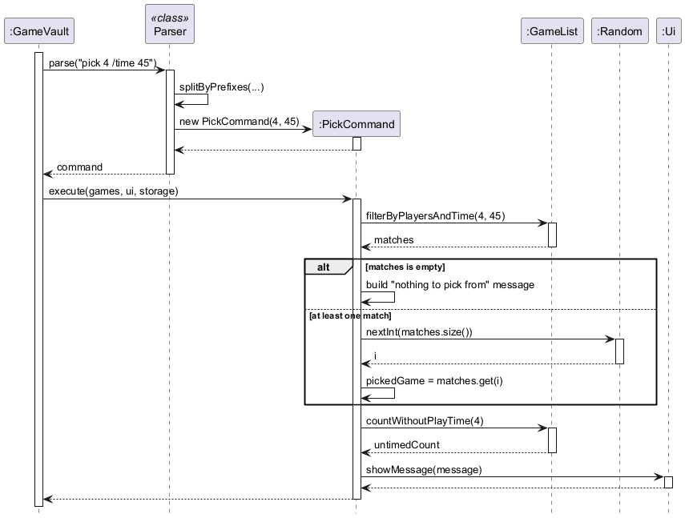

# Developer Guide

## Acknowledgements

{list here sources of all reused/adapted ideas, code, documentation, and third-party libraries -- include links to the original source as well}

## Design & implementation
### Edit feature

The edit feature lets the user change a game's title and/or player range without deleting and re-adding it.

**Parsing.** `Parser#parseEdit` splits the arguments just before each field prefix (`/title`, `/min`, `/max`),
so the fields can be given in any order. The first part is the `INDEX`, which is checked by `Parser#parseIndex`
(shared with `delete`). Each field is then checked on its own, e.g. `MIN` must be a whole number of at least 1,
and `TITLE` must not contain `|`. A field that is not given is passed to `EditCommand` as `null`,
meaning "keep the current value".

**Execution.** `EditCommand#execute` first checks that a game with that number exists. It then builds the new game,
taking each given field and falling back to the existing game's value for any field that was not given. Only then is
`MAX >= MIN` checked, because this rule depends on the game's current values (e.g. `edit 1 /min 5` must fail if the
game's current maximum is 4). If the check passes, `GameList#set` replaces the game at the same position and
`Storage#save` writes the updated collection to the data file.

**Design considerations.**
* *Where to check MIN/MAX:* the parser does not have access to the game list, so it cannot know the game's
  existing values. The check is therefore done in `EditCommand`, in the same way that `DeleteCommand` checks
  whether the index exists when it runs.
* *Replace in place vs. delete and re-add:* replacing keeps the game's number in `list` unchanged,
  which is less confusing for the user.

### Picking a random game (`pick`)

The `pick` command helps a host who cannot decide what to play. It picks one random game that fits tonight's
group, using the format `pick COUNT [/time MINUTES]`, e.g. `pick 4 /time 45`. It is implemented by
`Parser#parsePick` and `PickCommand`, and reuses the filtering methods of `GameList`, so `pick` and `filter` always
agree on which games fit.

The sequence diagram below shows what happens when the user enters `pick 4 /time 45`.



1. `Parser#parse(...)` sees the command word `pick` and calls `Parser#parsePick(...)`. This uses
   `Parser#splitByPrefixes(...)` to separate `COUNT` (`4`) from the optional `/time` value (`45`), and checks both
   with `Parser#parsePositiveNumber(...)`, so an invalid value such as `pick 0` or `pick 4 /time soon` is rejected
   with a `GameVaultException` before any command is created.
2. `parsePick` creates a `PickCommand(4, 45)`. If `/time` is not given, it uses `PickCommand(4)` instead, which
   stores `0` to mean "no time limit".
3. `GameVault` calls `PickCommand#execute(...)`. With a time limit, it asks the `GameList` for
   `filterByPlayersAndTime(4, 45)`. Without one, it uses `filterByPlayers(4)`. Either way, the collection itself is
   not changed, so `pick` never saves to the data file.
4. If no game matches, the message says there is nothing to pick from. Otherwise, `PickCommand` asks its `Random`
   object for `nextInt(matches.size())` and picks the game at that position.
5. With a time limit, `PickCommand` also calls `GameList#countWithoutPlayTime(4)`. Games with no play time
   recorded cannot be known to fit in 45 minutes, so they are left out, and the message says how many were left
   out. This matches what `filter` does.
6. `PickCommand` shows the result through `Ui#showMessage(...)`, e.g.
   `How about: Love Letter (2-4 players, 20 min)`.

#### Design considerations

**Aspect: How to make a random result testable**

* **Alternative 1 (current choice):** `PickCommand` takes a `Random` object. The public constructors create a
  normal `new Random()`, while a package-private constructor lets tests pass in their own.
  * Pros: Tests can pass a `Random` that always returns a chosen value, so they can check exactly which game is
    picked, e.g. that position 2 of the matches is chosen and that a game that does not fit is never chosen.
  * Cons: One extra constructor that only tests use.
* **Alternative 2:** Call `Math.random()` (or create a `new Random()`) inside `execute(...)`.
  * Pros: Slightly less code.
  * Cons: Tests could only check that *some* matching game was picked, not which one, so bugs such as an
    off-by-one in choosing the position could go unnoticed.

**Aspect: Where the filtering logic lives**

* **Alternative 1 (current choice):** Reuse `GameList#filterByPlayers(...)` and
  `GameList#filterByPlayersAndTime(...)`, which `filter` also uses.
  * Pros: `pick` and `filter` cannot disagree. A game shown by `filter 4 /time 45` is exactly a game that
    `pick 4 /time 45` can choose, and a fix to the filtering rules applies to both commands.
  * Cons: `pick` depends on how `filter` defines "fits", so the two cannot easily use different rules later.
* **Alternative 2:** Let `PickCommand` check each game itself.
  * Pros: `pick` could later use its own rules without affecting `filter`.
  * Cons: The same checks would exist in two places, which is duplicate code and makes the commands more likely
    to drift apart.

**Possible future improvement:** once play sessions are logged, `pick` could avoid games the group played
recently, so the same favourite is not suggested every time.

### Saving and loading games (Storage)

GameVault keeps the user's game collection between runs by saving it to a plain text file, `data/games.txt`.
This is handled by the `Storage` component in the `seedu.gamevault.storage` package, which has two classes:

* `Storage` reads the data file when the app starts and rewrites it whenever the collection changes.
* `GameDecoder` turns one line of the file back into a `Game`, checking that the line is valid.

Each game is stored on its own line in the format `TITLE | MIN | MAX | TIME`, where `MIN` and `MAX` are the
minimum and maximum player counts and `TIME` is the play time in minutes. `TIME` is left out when the user has not
recorded a play time. For example:

```
Catan | 3 | 4 | 60
Codenames | 4 | 8
```

The class diagram below shows how these classes relate to the rest of the app.


`GameVault` owns a single `Storage` object, created with the path of the data file. Commands that change the
collection (currently `add`, `delete` and `edit`) receive the same `Storage` object in `Command#execute(...)` and
use it to save. `Storage` depends on `GameDecoder` only for loading; saving uses `Game#toFileString()` directly.

#### Loading games at startup

When GameVault starts, `GameVault#loadGames()` asks `Storage` to prepare the data file and then load it.
The sequence diagram below shows what happens.


1. `GameVault` calls `Storage#createFileIfMissing()`, which creates the `data/` folder and an empty
   `games.txt` if they do not exist yet. An existing file is left untouched.
2. `GameVault` calls `Storage#load()`. If the file does not exist (e.g. it could not be created in step 1),
   `load()` returns an empty list, since a new user simply has no games yet.
3. Otherwise, `load()` reads every line of the file. Blank lines are ignored. Each other line is passed to
   `GameDecoder#decodeLine(...)`, which splits it on `|`, trims each part and checks that:
   * there are three or four parts,
   * `TITLE` is not empty,
   * `MIN` and `MAX` are whole numbers of at least 1,
   * `MAX` is not less than `MIN`, and
   * `TIME`, if present and not blank, is a whole number of at least 1. A missing or blank `TIME` means no play
     time is recorded.
4. A valid line becomes a `Game`. An invalid line causes `GameDecoder` to throw a `GameVaultException` whose
   message says exactly what is wrong (e.g. `MAX (2) is less than MIN (3)`). `Storage` catches it, records the
   line number, the line and the reason in its `skippedLines` list, and moves on to the next line.
5. `load()` returns the games from all the valid lines, and `GameVault` puts them into a new `GameList`.
6. If any lines were skipped, `GameVault` gets them from `Storage#getSkippedLines()` and passes them to
   `Ui#showSkippedLines(...)`, together with `GameDecoder.FORMAT`, so the user can see which lines were ignored
   and how to fix them.

If the file exists but cannot be read at all, `load()` throws a `GameVaultException`. `GameVault` shows the error
and starts with an empty collection instead of exiting.

#### Saving games after a change

Every command that changes the collection saves it straight away, so no changes are lost if the app closes
unexpectedly. The sequence diagram below shows this for the `add` command.


1. `AddCommand` adds the new game to the `GameList`.
2. `AddCommand` calls `Storage#save(games)`.
3. `save()` asks each `Game` for its line in the file through `Game#toFileString()`.
4. `save()` creates the `data/` folder if it is missing, then writes all the lines to the file, replacing its
   old contents.
5. If writing fails, `save()` throws a `GameVaultException`, which `GameVault` shows to the user as an error.

`DeleteCommand` and `EditCommand` save in the same way after removing or replacing a game.

#### Design considerations

**Aspect: File format**

* **Alternative 1 (current choice):** Plain text, one game per line, with fields separated by `|`.
  * Pros: Easy to implement with no extra libraries. Users can read and edit the file in any text editor.
  * Cons: The `|` character cannot be used in a game title without adding an escaping scheme.
* **Alternative 2:** JSON, using a library such as Jackson or Gson.
  * Pros: Handles special characters and nested data (e.g. tags for each game) easily.
  * Cons: Adds a third-party dependency, and the file is harder for users to edit by hand.

We chose plain text because each game has only a few simple fields, so the extra power of JSON is not needed yet.
New fields are added as optional fields at the end of the line: when play time was added, `TIME` became an optional
fourth field, so data files saved by older versions still load. If games gain many more fields later, switching to
JSON would only require changes inside the `Storage` component.

**Aspect: What to do with invalid lines when loading**

* **Alternative 1 (current choice):** Skip each invalid line, keep the valid ones, and tell the user which lines
  were skipped and why.
  * Pros: One mistake made while editing the file by hand does not cost the user their whole collection.
  * Cons: Skipped lines are lost the next time the collection is saved, because `save()` rewrites the file from
    the games in memory.
* **Alternative 2:** Stop loading and start with an empty collection as soon as one line is invalid.
  * Pros: Simpler to implement.
  * Cons: A single typo makes every game disappear, and the next save would overwrite the whole file.

We chose Alternative 1 because losing a few broken lines is much less harmful than losing every game. Showing the
exact line and reason lets the user fix the file before making further changes.

**Aspect: How to save**

* **Alternative 1 (current choice):** Rewrite the whole file after every change.
  * Pros: Simple, and works the same way for adding, deleting and any future editing commands.
  * Cons: Slower for very large collections, as every game is written each time.
* **Alternative 2:** Append a line when a game is added, and only rewrite the file for other changes.
  * Pros: Faster for the most common change.
  * Cons: Needs different saving logic for each kind of change, which makes bugs more likely.

We chose Alternative 1 because a game-night collection is small (tens to hundreds of games), so rewriting the
file takes very little time.

**Aspect: Where `GameDecoder` sits**

Decoding is kept in its own class instead of inside `Storage`, so that `Storage` deals only with files while
`GameDecoder` deals only with the line format. This also lets `GameDecoder` be unit-tested with plain strings,
without creating any files.

#### Possible future improvements

* Back up the data file (e.g. to `games.txt.bak`) before overwriting it whenever some lines were skipped during
  loading, so that the user can still recover those lines.
* Write to a temporary file first and then rename it over `games.txt`, so that a crash in the middle of saving
  cannot leave a half-written file.


## Product scope
### Target user profile

{Describe the target user profile}

### Value proposition

{Describe the value proposition: what problem does it solve?}

## User Stories

|Version| As a ... | I want to ... | So that I can ...|
|--------|----------|---------------|------------------|
|v1.0|new user|see usage instructions|refer to them when I forget how to use the application|
|v2.0|user|find a to-do item by name|locate a to-do without having to go through the entire list|

## Non-Functional Requirements

{Give non-functional requirements}

## Glossary

* *glossary item* - Definition

## Instructions for manual testing

{Give instructions on how to do a manual product testing e.g., how to load sample data to be used for testing}
